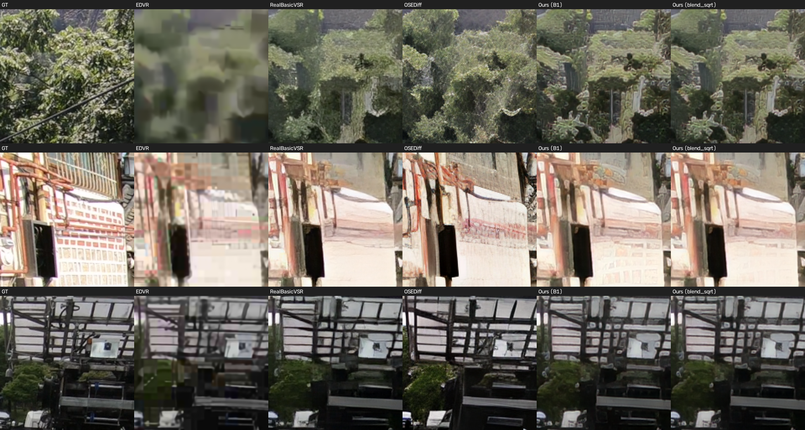
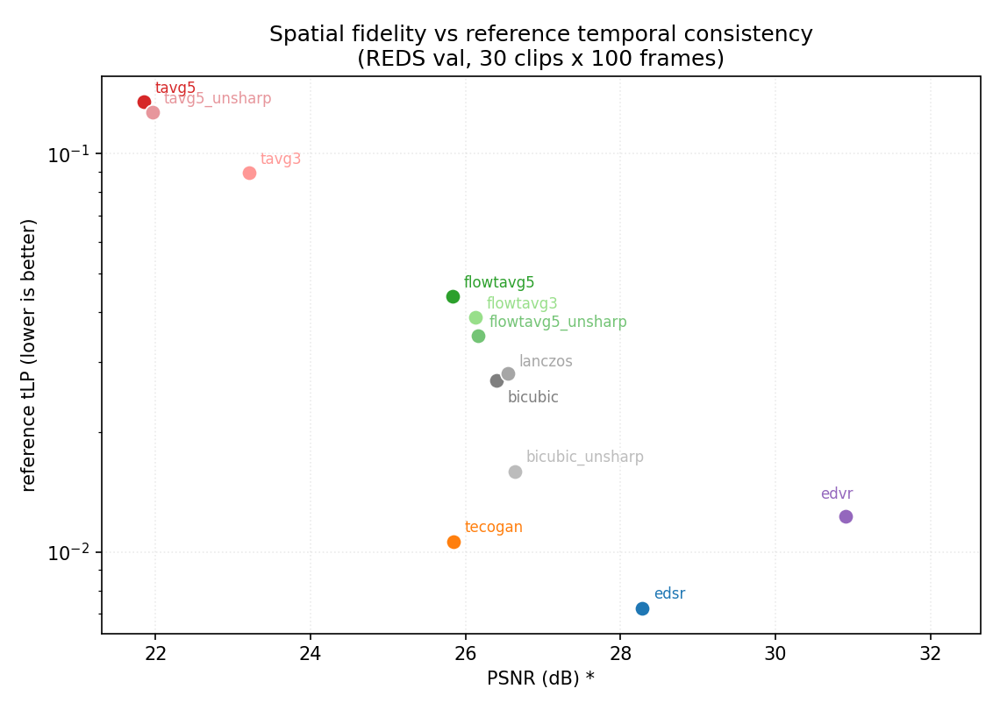
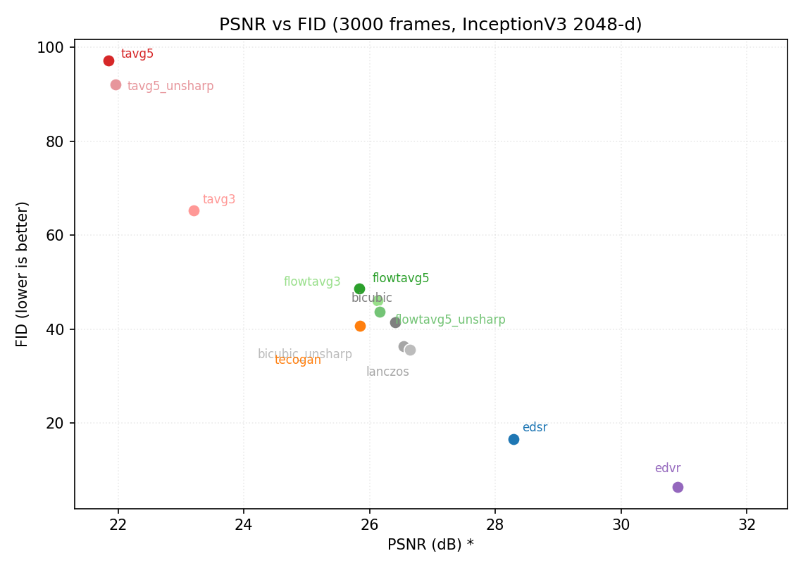

<div align="center">

# When Do Generative Priors Help Video Super-Resolution?

### A Systematic Benchmark, Degradation-Spectrum Study, and Pixel-Space Real-World Fine-Tuning

[](docs/BENCHMARKS_AND_DIAGNOSTICS.md)
[](pyproject.toml)
[](requirements.txt)
[](LICENSE)

[**English**](README.md) | [**中文**](README_zh.md)

[Key Findings](#key-findings) • [Main Results](#main-results) • [Repository Structure](#repository-structure) • [Documentation](#documentation-map) • [Quickstart](#quickstart--reproducibility) • [Demos](#demo-video-gallery) • [Citation](#citation)

</div>

---

## Abstract

Video Super-Resolution (VSR) benchmarks routinely report single-axis metrics under synthetic bicubic downsampling, obscuring the trade-offs among **pixel fidelity (PSNR/SSIM)**, **perceptual quality (LPIPS/DISTS/FID)**, and **temporal consistency (tLP, Flow-warp LPIPS, $E_{\text{warp}}$)**—and failing to predict model behavior under real-world degradations.

This repository presents a complete, audited $\times 4$ VSR investigation spanning **12 classical/learning-based baselines** on REDS, Vimeo-90K, and handheld Wild Video, **4 pixel-level uncertainty estimators**, **external diffusion/generative priors (OSEDiff, SUPIR, DOVE)** across **5 datasets**, and a **pixel-space multi-frame fine-tuning pipeline (`UA-RealBasicVSR`)** for real-world VSR.

> **Note on Repository Assets:** This repository contains source code, configurations, audited quantitative metrics, publication figures, and curated 2×2 comparison videos. Datasets and pretrained weights are excluded from git; see [`docs/DATASETS_AND_REPRODUCIBILITY.md`](docs/DATASETS_AND_REPRODUCIBILITY.md) for SHA256 manifests and download instructions.

<p align="center">
  
  <br/>
  <em>Visual comparison on REDS-Real (2nd-order real-world degradation): Ground Truth, clean-domain EDVR-L, RealBasicVSR, OSEDiff, and our 6.29M-parameter pixel-space fine-tuned models (<code>B1_uniform</code> and <code>blend_sqrt</code>).</em>
</p>

---

## Key Findings

1. **No Single Model Wins Every Axis on Clean Bicubic VSR (30 clips × 100 frames × 12 methods):**
   EDVR-L dominates PSNR (`30.904 dB`), SSIM (`0.8789`), LPIPS (`0.2039`), and FID (`6.31`), but trails EDSR (`0.0072`) and TecoGAN (`0.0106`) on formal reference-based tLP (`0.0123`). Moreover, **formal tLP and Flow-warp LPIPS rank methods in opposite directions** because excessive smoothing minimizes warp error while diverging from ground-truth motion dynamics ($d_{\text{SR}} \ll d_{\text{GT}}$). Both metrics must be reported side by side.
2. **Several Common Hypotheses Are Refuted by Controlled Audits:**
   - *Degradation mismatch* does **not** explain TecoGAN's 5.06 dB gap to EDVR (matching Gaussian $\sigma=1.5$ shifts TecoGAN by only `−0.26 dB`; training domain accounts for only `0.55 dB`).
   - *Motion magnitude* strongly amplifies optical-flow alignment gain ($\rho = +0.738, p < 0.001$), yet **EDVR's gain over EDSR is independent of motion** ($\rho = -0.012, p = 0.951$).
   - *Internal attention weights* (`U3_attn`) do **not** proxy predictive uncertainty ($\rho = -0.038$), whereas model disagreement (`U2`, $\rho = +0.404$) and flip-TTA spread (`U1`, $\rho = 0.36\text{–}0.46$) calibrate reliably.
3. **Degradation-Intensity Law Across 5 Datasets:**
   Whether generative priors help depends on **effective degradation severity**, not dataset provenance. On clean REDS bicubic and ~2× RealVSR, diffusion priors degrade texture LPIPS by `+152%` to `+197%` and lose `1.3–2.8 dB` PSNR. Under severe real-world degradation (**MVSR4x true ×4** and **REDS-Real**), clean-domain EDVR drops **below bicubic** (`20.916` vs `21.004 dB`), while generative priors lead on perceptual axes (`LPIPS −34.4%`).
4. **8× VAE Round-Trip Bottleneck Blocks Latent Residual Grafting:**
   Zero-shot chaining `RealBasicVSR → OSEDiff` worsens temporal warping error $E_{\text{warp}}$ by **4.4× relative to GT**. Training a zero-initialized SD 2.1 latent residual LoRA + uncertainty gate (**M2 Stage A**, 5 pilot arms) yields **No-Go** even after fixing 7 implementation defects: SD 2.1's 8× lossy VAE round-trip error (`~11.5/255`) matches RealBasicVSR's residual error floor.
5. **Pixel-Space Multi-Frame Fine-Tuning Outperforms 5B Diffusion Priors with 6.29M Parameters:**
   Bypassing the VAE and fine-tuning RealBasicVSR's propagation/upsampling branch (`3.37M` trainable / `6.29M` total) with `Charbonnier + DISTS + SN-UNet RaGAN + Occlusion-Aware L_temp` achieves the best perceptual scores on REDS-Real (**`B1_uniform`**: LPIPS `0.4573`, DISTS `0.1659`), outperforming OSEDiff (`E_warp 10.251`) and 800× larger DOVE 5B (`LPIPS 0.5149`).
6. **Honest Attribution on Uncertainty Routing & Blending:**
   - **Training-time $U_1$ weighting (`B2_uncertain`)** underperforms strictly mean-aligned uniform weighting (`B1_uniform`) across PSNR, LPIPS, and $E_{\text{warp}}$.
   - **Inference-time soft blending (`blend_sqrt`, $W = \sqrt{U_1}$)** beats baseline RealBasicVSR on all 4 metrics simultaneously, **but constant-weight controls ($\alpha \in [0.3, 0.7]$) also win all 4 metrics** and beat `blend_sqrt` on PSNR/LPIPS. Spatial structure in $U_1$ consistently helps **DISTS** (`27/30` clips vs mean-matched constant) while hurting textured-region PSNR (`−0.29 dB`). Accordingly, we report **`B1_uniform`** (perceptual peak) and **`blend_sqrt`** (zero-free-parameter balanced operating point) side by side.
   - **Cross-domain boundary:** On unseen dual-camera **MVSR4x**, pixel fidelity generalizes positively (`+0.096 dB` for `B1`, `+0.185 dB` for `blend_sqrt`), whereas perceptual LPIPS is in-domain specialized (`+10.7%` degradation for `B1`, reduced to `+0.33%` with `blend_sqrt`).

---

## Main Results

### 1. Clean Bicubic Benchmark — REDS Official Validation (30 clips × 100 frames)

Unified evaluation under `evalkit/` (`cutfr=0`, 99 adjacent pairs/clip for tLP, all 3,000 frames for FID). Full breakdown in [`docs/BENCHMARKS_AND_DIAGNOSTICS.md`](docs/BENCHMARKS_AND_DIAGNOSTICS.md).

| Method | Category | PSNR ↑ | SSIM ↑ | LPIPS ↓ | Flow-warp LPIPS ↓ | Formal tLP ↓ | FID ↓ |
|---|---|---:|---:|---:|---:|---:|---:|
| Bicubic | Interpolation | 26.403 | 0.7384 | 0.4835 | 0.0519 | 0.0270 | 41.41 |
| Lanczos | Interpolation | 26.546 | 0.7441 | 0.4861 | 0.0507 | 0.0281 | 36.33 |
| Bicubic + USM | Sharpening | 26.642 | 0.7517 | 0.4398 | 0.0642 | 0.0159 | 35.62 |
| EDSR ×4 (DIV2K) | Single-frame CNN | 28.284 | 0.8067 | 0.3087 | 0.0811 | **0.0072** | 16.56 |
| 3-Frame Avg (unaligned) | Naive Multi-frame | 23.203 | 0.6374 | 0.5595 | 0.1017 | 0.0895 | 65.26 |
| 5-Frame Avg (unaligned) | Naive Multi-frame | 21.852 | 0.5903 | 0.6052 | 0.0893 | 0.1351 | 97.15 |
| 5-Frame Avg + USM | Naive + Sharpen | 21.960 | 0.5983 | 0.5590 | 0.1006 | 0.1274 | 92.15 |
| 3-Frame Flow-Aligned | Optical-Flow Fusion | 26.132 | 0.7286 | 0.4993 | 0.0281 | 0.0387 | 46.12 |
| 5-Frame Flow-Aligned | Optical-Flow Fusion | 25.834 | 0.7195 | 0.5096 | **0.0236** | 0.0437 | 48.67 |
| 5-Frame Flow-Aligned + USM | Flow + Sharpen | 26.164 | 0.7364 | 0.4692 | 0.0276 | 0.0349 | 43.62 |
| **EDVR-L ×4 (REDS)** | **Deformable VSR** | **30.904** | **0.8789** | 0.2039 | 0.0647 | 0.0123 | **6.31** |
| TecoGAN ×4 | Recurrent GAN VSR | 25.843 | 0.7187 | 0.3337 | 0.0800 | 0.0106 | 40.65 |
| **FT-EDVR (DISTS+RaGAN)** | **Clean-Domain FT (Ours)** | 30.523 | — | **0.1402** | — | 0.0077 | — |

<p align="center">
  
  
</p>

### 2. Real-World VSR Main Results — REDS-Real Continuous 9-Frame Subset (30 clips × 270 frames)

Evaluated on 2nd-order real-world degradation (blur → resize → noise → JPEG → video compression, two passes) with paired GT. $E_{\text{warp}}$ is occlusion-aware flow reprojection error on `[0, 255]` luminance (GT self-warping = `5.757`). Full ablations in [`docs/REALWORLD_VSR_METHOD.md`](docs/REALWORLD_VSR_METHOD.md).

| Method | Params | PSNR ↑ | SSIM ↑ | LPIPS ↓ | DISTS ↓ | tLP ↓ | $E_{\text{warp}}$ ↓ | Beats RBV (All 4) |
|---|---:|---:|---:|---:|---:|---:|---:|---|
| Bicubic ×4 | — | **21.004** | 0.5019 | 0.7271 | 0.3463 | 0.0744 | **4.994** | — |
| EDVR-L (clean) | 20.7M | 20.916 | 0.4902 | 0.6351 | 0.3577 | 0.0630 | 5.528 | No |
| FT-EDVR (clean) | 20.7M | 20.862 | 0.4840 | 0.6163 | 0.3525 | 0.0631 | 5.738 | No |
| RealBasicVSR (baseline) | 6.29M | 20.822 | 0.4989 | 0.4881 | 0.2282 | 0.0443 | 6.346 | Baseline |
| DOVE (CogVideoX) | ~5B | 20.856 | **0.5023** | 0.5149 | 0.2392 | 0.0526 | 5.866 | No |
| OSEDiff (SD 2.1) | ~1.3B | 19.812 | 0.4454 | 0.4771 | 0.2235 | 0.0479 | 10.251 | No |
| RealBasicVSR → OSEDiff (zero-shot) | ~1.3B | 19.583 | 0.4747 | 0.5057 | 0.2227 | **0.0392** | 8.352 | No |
| **`B1_uniform` (Ours, pixel FT)** | **6.29M** | 20.583 | 0.4489 | **0.4573** | **0.1659** | 0.0564 | 6.535 | No (PSNR / $E_{\text{warp}}$) |
| `B2_uncertain` (train-time $U_1$ ablation) | 6.29M | 20.546 | 0.4479 | 0.4614 | 0.1660 | 0.0558 | 6.596 | No |
| **`blend_sqrt` (Ours, $W=\sqrt{U_1}$)** | **6.29M** | 20.835 | — | 0.4644 | 0.1806 | — | 5.663 | **Yes** |
| *`const_sqrt` (mean-matched control)* | *6.29M* | *20.943* | *—* | *0.4594* | *0.1879* | *—* | *5.641* | *Yes* |
| *`const_a600` (fixed $\alpha=0.6$ control)* | *6.29M* | *20.912* | *—* | *0.4562* | *0.1805* | *—* | *5.685* | *Yes* |

### 3. Degradation-Spectrum Law & Cross-Domain Boundaries

| Dataset | Effective Degradation | Best Fidelity (PSNR ↑) | Best Perceptual (LPIPS ↓) | Key Takeaway |
|---|---|---|---|---|
| **REDS-val** (30 clips) | Clean ×4 bicubic | EDVR (`30.904`) | FT-EDVR (`0.1402`) | Diffusion priors fail (`+152–197%` worse texture LPIPS) |
| **RealVSR** (50 clips) | Real ~2× (adapted to ×4) | EDVR (`23.036`) | FT-EDVR (`0.1979`) | Mild degradation favors regression; DOVE (`0.2215`) approaches EDVR |
| **MVSR4x** (15 clips) | True ×4 dual-camera | `const_0.5` (`22.263`) / `blend_sqrt` (`22.259`) vs Bicubic (`23.649`) | DOVE (`0.3670`) vs RBV (`0.3948`) / `blend_sqrt` (`0.3961`) | Severe real ×4: `B1` PSNR generalizes (`+0.096 dB`), LPIPS is in-domain specialized (`+10.7%` → `+0.33%` w/ `blend_sqrt`) |
| **REDS-Real** (30 clips) | 2nd-order real degradation | Bicubic (`21.004`) / `const_a400` (`20.964`) | **`B1_uniform` (`0.4573`)** | Clean EDVR drops below bicubic; 6.29M pixel-space FT beats 5B diffusion |
| **VideoLQ** (50 clips, no GT) | Wild internet videos | *(No GT)* | MUSIQ: OSEDiff (`66.85`), **`B1` (`59.35`) vs RBV (`48.13`)** | Fine-tuning recovers `+11.2` MUSIQ over baseline RBV while cutting HR $E_{\text{warp}}$ by `3.2%` |

---

## Repository Structure

```text
aiaa3201-proj/
├── README.md                          # English paper-grade overview (this file)
├── README_zh.md                       # Chinese paper-grade overview
├── LICENSE                            # MIT License + third-party notices
├── pyproject.toml                     # Installable package (`evalkit`, `models`)
├── requirements.txt                   # Core & optional dependency list
├── configs/                           # Evaluation & training YAML/JSON specs
│   ├── eval_reds_val.yaml
│   ├── realworld_rbvsr_ft.yaml
│   ├── edvr_perceptual_ft.json
│   └── iqa_protocol.json
├── evalkit/                           # Unified audited evaluation toolkit (PSNR/SSIM/LPIPS/tLP/Flow-warp)
├── models/                            # Standalone RealBasicVSR, UA-RealBasicVSR, occlusion-aware warp
├── experiments/                       # Reproducible experiment suites by research stage
│   ├── 01_baselines/                  # Part 1: Hand-crafted interpolation, EDSR, flow calibration
│   ├── 02_sota_benchmarks/            # Part 2 + P0: 12-method REDS-val, Vimeo-90K, diagnostics
│   ├── 03_wild_video/                 # Handheld real-world video benchmark (5 sources × 20 clips)
│   ├── 04_uncertainty_and_ft/         # U1–U4 uncertainty calibration, TTA, IQA suite, EDVR FT
│   ├── 05_generative_priors/          # Cross-domain OSEDiff / SUPIR / DOVE / RBVSR qualification
│   ├── 06_realworld_pixel_ft/         # Final M2-B pixel-space FT, soft blending, cross-domain eval
│   └── demo_generation/               # 1080p / 24 fps 2×2 comparison video builders
├── results/                           # All audited JSON metrics, summary tables, self-checks & figures
│   ├── figures/                       # Curated figures grouped by study
│   ├── 01_baselines/ ... 06_realworld_pixel_ft/
├── demos/                             # Deliverable 2×2 comparison videos (1920×1080, 24 fps H.264)
│   ├── reds_sota/                     # 6 REDS clips (normal + 2× loupe inset)
│   ├── wild/                          # 5 handheld Wild clips (normal + inset)
│   ├── wild_source/                   # 5 original un-transcoded mobile source recordings
│   └── realworld_vsr/                 # 3 REDS-Real clips (EDVR / RBV / OSEDiff / Ours)
├── docs/                              # Consolidated academic documentation suite
└── archive/                           # Terminated explorations preserved for provenance (U-TRD, StableSR, Stage A)
```

---

## Documentation Map

| Document | Scope |
|---|---|
| [`docs/EVALUATION_PROTOCOL.md`](docs/EVALUATION_PROTOCOL.md) | Formal definitions of PSNR, SSIM, LPIPS, DISTS, formal tLP vs Flow-warp LPIPS, occlusion-aware $E_{\text{warp}}$, FID, NIQE/MUSIQ/DOVER; metric audits and known pitfalls. |
| [`docs/BENCHMARKS_AND_DIAGNOSTICS.md`](docs/BENCHMARKS_AND_DIAGNOSTICS.md) | Full 12-method REDS-val benchmark, Vimeo-90K cross-weight study, motion stratification, alignment diagnostics (FB consistency mask), degradation-mismatch refutation, EDVR neighbor ablation, and speed/VRAM profiling. |
| [`docs/WILD_VIDEO_STUDY.md`](docs/WILD_VIDEO_STUDY.md) | Handheld Wild Video benchmark (5 sources × 20 clips × 12 methods), inverted-U multi-frame gain, and synthesis protocol caveats. |
| [`docs/REALWORLD_VSR_METHOD.md`](docs/REALWORLD_VSR_METHOD.md) | Complete Direction C narrative: uncertainty estimators (`U1–U4`), clean-domain EDVR perceptual fine-tuning, 5-dataset degradation spectrum, `UA-RealBasicVSR` pixel-space fine-tuning, soft-blending curve, constant-blend refutation, and cross-domain boundaries. |
| [`docs/NEGATIVE_RESULTS_AND_ABLATIONS.md`](docs/NEGATIVE_RESULTS_AND_ABLATIONS.md) | Dedicated record of all controlled negative/No-Go results (`U3` attention, bicubic routing, U-TRD, StableSR fusion, M2 Stage A 8× VAE bottleneck & cyan bias, training-time $U_1$ weighting, spatial vs constant blend attribution). |
| [`docs/DATASETS_AND_REPRODUCIBILITY.md`](docs/DATASETS_AND_REPRODUCIBILITY.md) | Dataset specifications, SHA256 checkpoint manifest, REDS split-overlap audit, environment installation, and end-to-end reproduction commands. |
| [`archive/README.md`](archive/README.md) | Index of archived superseded explorations (`utrd/`, `stablesr_fusion/`, `m2_stageA_latent_lora/`). |

---

## Quickstart & Reproducibility

### 1. Environment Installation

```bash
git clone https://github.com/logiyaxh-droid/aiaa3201-proj.git
cd aiaa3201-proj
pip install -e .
# Optional: perceptual IQA (DISTS, MUSIQ, NIQE) and diffusion priors
pip install -e ".[iqa,priors]"
```

### 2. Configure Data & Checkpoint Paths

All core modules resolve paths from environment variables (no hardcoded user directories):

```bash
export VSR_DATA_ROOT=/path/to/project1_video_sr
export VSR_CKPT_ROOT=/path/to/checkpoints
export RBVSR_CKPT=$VSR_CKPT_ROOT/RealBasicVSR_x4.pth
export RBVSR_DATA=/path/to/reds_real_c9
export TORCH_HOME=~/.cache/torch
```

### 3. Run Unified Benchmarks & Real-World Fine-Tuning

```bash
# Unified 12-method REDS-val evaluation (resumable; smoke-test with --clips 000)
python experiments/02_sota_benchmarks/full_eval.py --out outputs/full --clips 000 --methods bicubic --verify-clip 000
python experiments/02_sota_benchmarks/fid_full.py outputs/full
python experiments/02_sota_benchmarks/aggregate_full.py outputs/full

# Real-world pixel-space multi-frame fine-tuning (B1_uniform: 1,500 steps, ~5.8 GB VRAM)
python experiments/06_realworld_pixel_ft/selfcheck_rbv.py
python experiments/06_realworld_pixel_ft/train_rbv_ft.py --name B1_uniform --uniform

# Whole-clip inference & U1 soft blending / constant-weight controls
python experiments/06_realworld_pixel_ft/eval_rbv_ft.py --run runs/realworld_pixel_ft/B1_uniform/last.pth --name full_b1
python experiments/06_realworld_pixel_ft/blend_sweep.py
```

Full step-by-step reproduction commands for every table and figure are provided in [`docs/DATASETS_AND_REPRODUCIBILITY.md`](docs/DATASETS_AND_REPRODUCIBILITY.md).

---

## Demo Video Gallery

All deliverable comparison videos share a unified specification: **1920×1080 / 24 fps / H.264 `yuv420p` / CRF 18 / `+faststart`**, provided in both full-frame and **2× magnified loupe inset** (`_inset`) variants.

| Suite | Layout (2×2) | Clips Included | Location |
|---|---|---|---|
| **Real-World VSR (Final)** | EDVR \| RealBasicVSR / OSEDiff \| Ours (`blend_sqrt`) | `000` (brick wall), `005` (scaffolding), `016` (foliage) — 100 frames | [`demos/realworld_vsr/`](demos/realworld_vsr/) |
| **REDS Clean SOTA** | GT \| Bicubic / EDVR-L \| TecoGAN | `002`, `011`, `013`, `015`, `016`, `018` + [`picks_sheet.png`](demos/reds_sota/picks_sheet.png) | [`demos/reds_sota/`](demos/reds_sota/) |
| **Wild Video (Handheld)** | GT \| Bicubic / EDVR-L \| TecoGAN | `A02`, `B01`, `C03`, `D00`, `E00` (+ raw sources in [`demos/wild_source/`](demos/wild_source/)) | [`demos/wild/`](demos/wild/) |

---

## Citation

If you find this benchmark, audited evaluation toolkit, or empirical findings useful in your research or coursework, please cite:

```bibtex
@misc{aiaa3201_vsr_2026,
  title  = {When Do Generative Priors Help Video Super-Resolution? A Systematic Benchmark, Degradation-Spectrum Study, and Pixel-Space Real-World Fine-Tuning},
  author = {AIAA3201 Project Contributors},
  year   = {2026},
  howpublished = {\url{https://github.com/logiyaxh-droid/aiaa3201-proj}}
}
```

## Acknowledgments

We gratefully acknowledge the authors of the upstream architectures, toolkits, and datasets used in our evaluations:
[BasicSR](https://github.com/XPixelGroup/BasicSR) (EDSR, EDVR, BasicVSR++), [TecoGAN](https://github.com/thunil/TecoGAN), [RealBasicVSR](https://github.com/ckkelvinchan/RealBasicVSR), OSEDiff, SUPIR, DOVE, REDS (Nah et al., CVPRW 2019), Vimeo-90K (Xue et al., IJCV 2019), RealVSR (Yang et al., ICCV 2021), MVSR4x (CVPRW 2023), and VideoLQ (Chan et al., CVPR 2022).

## License

This project is released under the [MIT License](LICENSE). Third-party weights and datasets remain subject to their original licenses.
