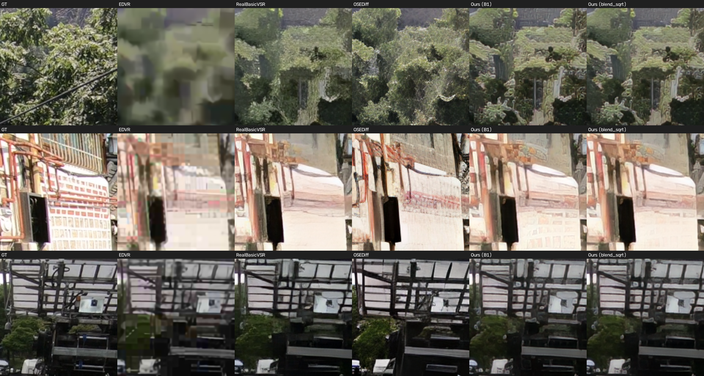
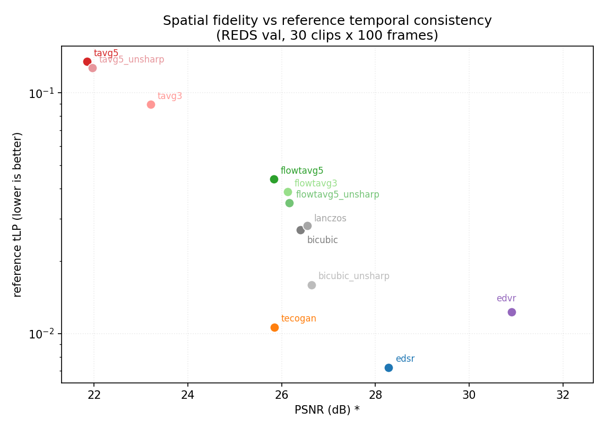
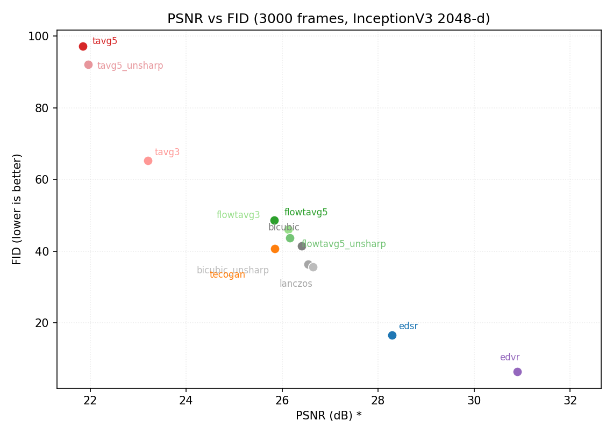

<div align="center">

# 生成先验何时真正有助于视频超分辨率？

### 系统性多轴基准、退化光谱定律与真实退化像素空间微调研究

[](docs/BENCHMARKS_AND_DIAGNOSTICS.md)
[](pyproject.toml)
[](requirements.txt)
[](LICENSE)

[**English**](README.md) | [**中文**](README_zh.md)

[核心发现](#核心发现) • [主要实验结果](#主要实验结果) • [仓库结构](#仓库结构) • [文档导航](#文档导航) • [快速开始与复现](#快速开始与复现) • [演示视频](#演示视频总览) • [引用](#引用)

</div>

---

## 摘要

现有的视频超分辨率（VSR）评测通常聚焦于合成双三次（bicubic）下采样上的单一指标，掩盖了**像素保真（PSNR/SSIM）**、**感知质量（LPIPS/DISTS/FID）**与**时序一致性（正式 tLP、Flow-warp LPIPS、$E_{\text{warp}}$）**之间的深层权衡，也难以预测模型在真实世界退化下的表现。

本仓库记录了 AIAA3201 课程项目的完整研究与实证审计：涵盖 REDS、Vimeo-90K 与自拍 Wild Video 上的 **12 个经典与 SOTA 方法统一基准**、**4 类像素级不确定性估计量校准**、跨越 **5 个数据集** 的外部扩散/生成先验（OSEDiff、SUPIR、DOVE）资格评测，以及针对真实退化设计的 **像素空间多帧端到端微调方案（`UA-RealBasicVSR`，仅 6.29M 参数）** 与诚实的消融归因。

> **资产说明**：本仓库仅包含源码、配置、审计后的定量指标、论文图表与精选 2×2 演示视频。数据集与预训练模型权重均不入库，获取方式与 SHA256 核验清单见 [`docs/DATASETS_AND_REPRODUCIBILITY.md`](docs/DATASETS_AND_REPRODUCIBILITY.md)。

<p align="center">
  
  <br/>
  <em>REDS-Real（二阶真实退化）六路纹理对比：真值（GT）、干净域 EDVR-L、RealBasicVSR、OSEDiff，以及本文 6.29M 参数像素空间微调模型（<code>B1_uniform</code> 与 <code>blend_sqrt</code>）。</em>
</p>

---

## 核心发现

1. **干净双三次域上没有任何单一模型同时赢下所有轴（30 clip × 100 帧 × 12 方法）**：
   EDVR-L 在 PSNR（`30.904 dB`）、SSIM（`0.8789`）、LPIPS（`0.2039`）与 FID（`6.31`）上全面领先，但在参考式正式 tLP（`0.0123`）上劣于 EDSR（`0.0072`）与 TecoGAN（`0.0106`）。更重要的是，**正式 tLP 与无参考 Flow-warp LPIPS 的方法排序几乎相反**：过度平滑虽压低光流重投影差，却使输出帧间变化 $d_{\text{SR}}$ 严重偏离真值 $d_{\text{GT}}$，因此两类时序指标必须并列报告。
2. **多项常见直觉与假设被对照实验否定**：
   - *退化失配* **并非** TecoGAN 落后 EDVR 5.06 dB 的主因（换回其匹配的高斯 $\sigma=1.5$ 退化核后 TecoGAN 仅变化 `−0.26 dB`；训练数据域差异仅解释 `0.55 dB`）。
   - *运动强度* 显著放大传统光流对齐收益（$\rho = +0.738, p < 0.001$），但 **EDVR 相对 EDSR 的增益与运动强度无关**（$\rho = -0.012, p = 0.951$）。
   - *网络内部注意力权重*（`U3_attn`）**不能**充当预测不确定性代理（$\rho = -0.038$），而模型分歧（`U2`，$\rho = +0.404$）与翻转 TTA 离散度（`U1`，$\rho = 0.36\text{–}0.46$）校准良好。
3. **跨 5 大数据集的“退化强度定律”**：
   决定生成先验是否有效的是**有效退化强度**，而非数据来源标签。在干净 REDS bicubic 与 ~2× 轻退化 RealVSR 上，真实退化扩散先验的纹理块 LPIPS 劣于微调 EDVR `152%–197%`、PSNR 低 `1.3–2.8 dB`；而在重度真实退化（**MVSR4x 真 ×4** 与 **REDS-Real**）上，干净域 EDVR **连 bicubic 都打不过**（`20.916` vs `21.004 dB`），生成先验则在感知轴全面反超（`LPIPS −34.4%`）。
4. **8× 有损 VAE 往返瓶颈否定了潜空间残差嫁接路线**：
   零样本串联 `RealBasicVSR → OSEDiff` 使相对 GT 的时序重投影偏移扩大 **4.4 倍**；进一步训练零初始化 SD 2.1 潜空间残差 LoRA + 不确定性门控（**M2 Stage A**，五臂 Pilot），即便在审计并修复 7 处代码缺陷后仍全线 **No-Go**：SD 2.1 的 8× VAE 往返误差（`~11.5/255`）与 RealBasicVSR 的剩余误差同阶，并引入 8×8 青色通道偏置伪影。
5. **6.29M 参数像素空间多帧微调全面超越 5B 扩散模型**：
   绕开 VAE，冻结 `image_cleaning` 与 `spynet`，在像素空间对 RealBasicVSR 的传播与上采样分支（`3.37M` 可训练 / `6.29M` 总参数）联合优化 `Charbonnier + DISTS + SN-UNet RaGAN + 遮挡感知 L_temp`。在 REDS-Real 上，**`B1_uniform`** 拿下全场最佳 LPIPS（`0.4573`）与 DISTS（`0.1659`），同时全面优于 OSEDiff（$E_{\text{warp}}$ 降低 `36.3%`）与参数量大 800 倍的 DOVE 5B（LPIPS `0.5149`）。
6. **关于不确定性路由与软融合的诚实归因**：
   - **训练期 $U_1$ 加权（`B2_uncertain`）** 在严格均值对齐下仍劣于均匀加权（`B1_uniform`）。
   - **推理期软融合（`blend_sqrt`，$W=\sqrt{U_1}$）** 相对原版 RealBasicVSR 实现四项全胜，但**补测的固定常数对照（$\alpha \in [0.3, 0.7]$）同样四项全胜**且在 PSNR/LPIPS 上更优。$U_1$ 空间结构唯一稳定受益的指标是 **DISTS**（`27/30` 片段优于同均值常数），在纹理区 PSNR 上反而低 `0.29 dB`。因此终稿**并列报告 `B1_uniform`（单点感知最强）与 `blend_sqrt`（零自由参数均衡形态）**，不隐瞒权衡。
   - **跨域边界**：在未见过的双摄真实数据集 **MVSR4x** 上，保真轴正向泛化（`B1` `+0.096 dB`，`blend_sqrt` `+0.185 dB`），但感知轴呈同域特化（`B1` LPIPS 变差 `+10.7%`，经 `blend_sqrt` 缓解至 `+0.33%`）。

---

## 主要实验结果

### 1. 干净双三次基准 — REDS 官方验证集（30 clip × 100 帧）

在统一评测包 `evalkit/` 下全量复算（`cutfr=0`，每段 99 个相邻帧对计算 tLP，全量 3,000 帧计算 FID）。完整分析见 [`docs/BENCHMARKS_AND_DIAGNOSTICS.md`](docs/BENCHMARKS_AND_DIAGNOSTICS.md)。

| 方法 | 类别 | PSNR ↑ | SSIM ↑ | LPIPS ↓ | Flow-warp LPIPS ↓ | 正式 tLP ↓ | FID ↓ |
|---|---|---:|---:|---:|---:|---:|---:|
| Bicubic | 插值基线 | 26.403 | 0.7384 | 0.4835 | 0.0519 | 0.0270 | 41.41 |
| Lanczos | 插值基线 | 26.546 | 0.7441 | 0.4861 | 0.0507 | 0.0281 | 36.33 |
| Bicubic + USM | 锐化基线 | 26.642 | 0.7517 | 0.4398 | 0.0642 | 0.0159 | 35.62 |
| EDSR ×4 (DIV2K) | 单帧深度超分 | 28.284 | 0.8067 | 0.3087 | 0.0811 | **0.0072** | 16.56 |
| 3 帧平均（无对齐） | 朴素多帧 | 23.203 | 0.6374 | 0.5595 | 0.1017 | 0.0895 | 65.26 |
| 5 帧平均（无对齐） | 朴素多帧 | 21.852 | 0.5903 | 0.6052 | 0.0893 | 0.1351 | 97.15 |
| 5 帧平均 + USM | 朴素多帧+锐化 | 21.960 | 0.5983 | 0.5590 | 0.1006 | 0.1274 | 92.15 |
| 3 帧光流对齐 | 光流融合 | 26.132 | 0.7286 | 0.4993 | 0.0281 | 0.0387 | 46.12 |
| 5 帧光流对齐 | 光流融合 | 25.834 | 0.7195 | 0.5096 | **0.0236** | 0.0437 | 48.67 |
| 5 帧光流对齐 + USM | 光流+锐化 | 26.164 | 0.7364 | 0.4692 | 0.0276 | 0.0349 | 43.62 |
| **EDVR-L ×4 (REDS)** | **可变形对齐 VSR** | **30.904** | **0.8789** | 0.2039 | 0.0647 | 0.0123 | **6.31** |
| TecoGAN ×4 | 循环 GAN VSR | 25.843 | 0.7187 | 0.3337 | 0.0800 | 0.0106 | 40.65 |
| **FT-EDVR (DISTS+RaGAN)** | **干净域微调（本文）** | 30.523 | — | **0.1402** | — | 0.0077 | — |

<p align="center">
  
  
</p>

### 2. 真实退化主表 — REDS-Real 连续 9 帧子集（30 clip × 270 帧）

采用 RealBasicVSR 二阶真实退化（模糊 → 随机缩放 → 噪声 → JPEG → 视频压缩，两遍）保留配对 GT。$E_{\text{warp}}$ 为 `[0, 255]` 灰度域遮挡感知重投影误差（GT 自身为 `5.757`）。详见 [`docs/REALWORLD_VSR_METHOD.md`](docs/REALWORLD_VSR_METHOD.md)。

| 方法 | 参数量 | PSNR ↑ | SSIM ↑ | LPIPS ↓ | DISTS ↓ | tLP ↓ | $E_{\text{warp}}$ ↓ | 四项全胜 RBV |
|---|---:|---:|---:|---:|---:|---:|---:|---|
| Bicubic ×4 | — | **21.004** | 0.5019 | 0.7271 | 0.3463 | 0.0744 | **4.994** | — |
| EDVR-L（干净域） | 20.7M | 20.916 | 0.4902 | 0.6351 | 0.3577 | 0.0630 | 5.528 | 否 |
| FT-EDVR（干净域） | 20.7M | 20.862 | 0.4840 | 0.6163 | 0.3525 | 0.0631 | 5.738 | 否 |
| RealBasicVSR（基线） | 6.29M | 20.822 | 0.4989 | 0.4881 | 0.2282 | 0.0443 | 6.346 | 基线 |
| DOVE (CogVideoX) | ~5B | 20.856 | **0.5023** | 0.5149 | 0.2392 | 0.0526 | 5.866 | 否 |
| OSEDiff (SD 2.1) | ~1.3B | 19.812 | 0.4454 | 0.4771 | 0.2235 | 0.0479 | 10.251 | 否 |
| RealBasicVSR → OSEDiff（零样本串联） | ~1.3B | 19.583 | 0.4747 | 0.5057 | 0.2227 | **0.0392** | 8.352 | 否 |
| **`B1_uniform`（本文，像素微调）** | **6.29M** | 20.583 | 0.4489 | **0.4573** | **0.1659** | 0.0564 | 6.535 | 否（PSNR / $E_{\text{warp}}$） |
| `B2_uncertain`（训练期 $U_1$ 消融） | 6.29M | 20.546 | 0.4479 | 0.4614 | 0.1660 | 0.0558 | 6.596 | 否 |
| **`blend_sqrt`（本文，$W=\sqrt{U_1}$）** | **6.29M** | 20.835 | — | 0.4644 | 0.1806 | — | 5.663 | **是** |
| *`const_sqrt`（同均值常数对照）* | *6.29M* | *20.943* | *—* | *0.4594* | *0.1879* | *—* | *5.641* | *是* |
| *`const_a600`（固定 $\alpha=0.6$ 对照）* | *6.29M* | *20.912* | *—* | *0.4562* | *0.1805* | *—* | *5.685* | *是* |

### 3. 退化光谱定律与跨域泛化边界

| 数据集 | 有效退化强度 | 最优保真（PSNR ↑） | 最优感知（LPIPS ↓） | 核心结论 |
|---|---|---|---|---|
| **REDS-val**（30 段） | 干净 ×4 bicubic | EDVR（`30.904`） | FT-EDVR（`0.1402`） | 外部生成先验全线失败（纹理块 LPIPS 劣 152–197%） |
| **RealVSR**（50 段） | 真实 ~2×（适配至 ×4） | EDVR（`23.036`） | FT-EDVR（`0.1979`） | 轻度退化下回归模型占优；DOVE（`0.2215`）逼近 EDVR |
| **MVSR4x**（15 段） | 真实双摄 ×4 | `const_0.5`（`22.263`）/ `blend_sqrt`（`22.259`）对 Bicubic（`23.649`） | DOVE（`0.3670`）对 RBV（`0.3948`）/ `blend_sqrt`（`0.3961`） | 保真轴跨域正向（`B1` `+0.096 dB`），感知轴同域特化（`+10.7%` → `blend_sqrt` 收回至 `+0.33%`） |
| **REDS-Real**（30 段） | 二阶真实退化 | Bicubic（`21.004`）/ `const_a400`（`20.964`） | **`B1_uniform`（`0.4573`）** | 干净域 EDVR 跌破 bicubic；6.29M 像素微调超越 5B 扩散 |
| **VideoLQ**（50 段，无 GT） | 真实网络视频 | *（无 GT）* | MUSIQ：OSEDiff（`66.85`），**`B1`（`59.35`）对 RBV（`48.13`）** | 相对原版 RBV 回收 `+11.2` MUSIQ 且同分辨率 $E_{\text{warp}}$ 降低 `3.2%` |

---

## 仓库结构

```text
aiaa3201-proj/
├── README.md                          # 英文论文级主文档
├── README_zh.md                       # 中文论文级主文档（本文件）
├── LICENSE                            # MIT 开源协议及第三方声明
├── pyproject.toml                     # Python 包定义（导出 evalkit 与 models）
├── requirements.txt                   # 核心与可选依赖清单
├── configs/                           # 评测与训练 YAML/JSON 配置模板
├── evalkit/                           # 统一审计评测包（PSNR/SSIM/LPIPS/tLP/Flow-warp）
├── models/                            # 核心网络结构（RealBasicVSR、UA-RealBasicVSR、遮挡光流 warp）
├── experiments/                       # 按研究阶段组织的可复现实验代码
│   ├── 01_baselines/                  # Part 1：插值 / EDSR / 多帧平均 / 光流标定
│   ├── 02_sota_benchmarks/            # Part 2 + P0：12 方法全量 REDS、Vimeo-90K 与全套诊断
│   ├── 03_wild_video/                 # 自拍 Wild Video 评测（5 源 × 20 片段 × 12 方法）
│   ├── 04_uncertainty_and_ft/         # U1–U4 不确定性校准、TTA、感知 IQA 与 EDVR 感知微调
│   ├── 05_generative_priors/          # 外部生成先验跨 5 数据集资格评测
│   ├── 06_realworld_pixel_ft/         # 最终 M2-B 像素空间微调、软融合与跨域验收
│   └── demo_generation/               # 1080p / 24 fps 2×2 演示视频合成脚本
├── results/                           # 全量定量 JSON、汇总表、自检报告与论文图表
│   ├── figures/                       # 按主题整理的论文级配图
│   ├── 01_baselines/ ... 06_realworld_pixel_ft/
├── demos/                             # 成品 2×2 对比视频（1920×1080，24 fps H.264）
│   ├── reds_sota/                     # REDS 6 片段（普通版 + 2× 放大镜版）
│   ├── wild/                          # Wild Video 5 片段（普通版 + 放大镜版）
│   ├── wild_source/                   # 5 段手机原始未重压缩素材
│   └── realworld_vsr/                 # REDS-Real 3 片段（EDVR / RBV / OSEDiff / Ours）
├── docs/                              # 系统化英文学术专题文档（6 篇）
└── archive/                           # 已终止探索的完整归档（U-TRD、StableSR、M2 Stage A）
```

---

## 文档导航

| 文档 | 内容概要 |
|---|---|
| [`docs/EVALUATION_PROTOCOL.md`](docs/EVALUATION_PROTOCOL.md) | 全部空间/感知/时序/分布指标（PSNR/SSIM/LPIPS/DISTS/正式 tLP/Flow-warp LPIPS/$E_{\text{warp}}$/FID/NIQE/MUSIQ/DOVER）定义、口径审计与常见陷阱。 |
| [`docs/BENCHMARKS_AND_DIAGNOSTICS.md`](docs/BENCHMARKS_AND_DIAGNOSTICS.md) | 12 方法全量 REDS、Vimeo-90K 权重错配实验、运动三分位分组、光流前后向一致性诊断、TecoGAN 退化失配证伪、EDVR 邻帧消融与速度/显存基准。 |
| [`docs/WILD_VIDEO_STUDY.md`](docs/WILD_VIDEO_STUDY.md) | 自拍真实视频评测（5 源 × 20 片段 × 12 方法）、多帧收益倒 U 形规律与口径声明。 |
| [`docs/REALWORLD_VSR_METHOD.md`](docs/REALWORLD_VSR_METHOD.md) | Direction C 完整研究主线：不确定性校准、干净域 EDVR 微调、5 数据集退化光谱、`UA-RealBasicVSR` 像素微调、软融合曲线、常数对照证伪与跨域边界。 |
| [`docs/NEGATIVE_RESULTS_AND_ABLATIONS.md`](docs/NEGATIVE_RESULTS_AND_ABLATIONS.md) | 全项目负面结果与消融专章（U3 注意力失效、bicubic 路由失效、U-TRD、StableSR、M2 Stage A 8× VAE 瓶颈与青色伪影、训练期 $U_1$ 加权与空间融合归因）。 |
| [`docs/DATASETS_AND_REPRODUCIBILITY.md`](docs/DATASETS_AND_REPRODUCIBILITY.md) | 数据集规格、权重 SHA256 清单、REDS 划分零重叠核查、环境重建与端到端复现命令。 |
| [`archive/README.md`](archive/README.md) | 已归档探索目录说明（`utrd/`、`stablesr_fusion/`、`m2_stageA_latent_lora/`）。 |

---

## 快速开始与复现

### 1. 安装环境

```bash
git clone https://github.com/logiyaxh-droid/aiaa3201-proj.git
cd aiaa3201-proj
pip install -e .
# 可选：安装感知 IQA（DISTS/MUSIQ/NIQE）与外部生成先验依赖
pip install -e ".[iqa,priors]"
```

### 2. 配置数据与权重环境变量

核心模块均已解耦本地服务器路径，通过环境变量指定根目录即可运行：

```bash
export VSR_DATA_ROOT=/path/to/project1_video_sr
export VSR_CKPT_ROOT=/path/to/checkpoints
export RBVSR_CKPT=$VSR_CKPT_ROOT/RealBasicVSR_x4.pth
export RBVSR_DATA=/path/to/reds_real_c9
export TORCH_HOME=~/.cache/torch
```

### 3. 运行核心评测与像素空间微调

```bash
# 统一 12 方法 REDS-val 评测（支持断点续跑；可用 --clips 000 做冒烟核对）
python experiments/02_sota_benchmarks/full_eval.py --out outputs/full --clips 000 --methods bicubic --verify-clip 000
python experiments/02_sota_benchmarks/fid_full.py outputs/full
python experiments/02_sota_benchmarks/aggregate_full.py outputs/full

# 真实退化像素空间多帧微调（B1_uniform：1,500 步，峰值显存 ~5.8 GB）
python experiments/06_realworld_pixel_ft/selfcheck_rbv.py
python experiments/06_realworld_pixel_ft/train_rbv_ft.py --name B1_uniform --uniform

# 全量推理与 U1 软融合 / 常数对照组扫描
python experiments/06_realworld_pixel_ft/eval_rbv_ft.py --run runs/realworld_pixel_ft/B1_uniform/last.pth --name full_b1
python experiments/06_realworld_pixel_ft/blend_sweep.py
```

每张主表与图表的完整复现命令见 [`docs/DATASETS_AND_REPRODUCIBILITY.md`](docs/DATASETS_AND_REPRODUCIBILITY.md)。

---

## 演示视频总览

所有成品视频均统一编码为 **1920×1080 / 24 fps / H.264 `yuv420p` / CRF 18 / `+faststart`**，每片段均提供普通全帧版与 **2× 局部放大镜版（`_inset`）**。

| 系列 | 2×2 四路布局 | 包含片段 | 目录 |
|---|---|---|---|
| **真实退化 VSR（终版）** | EDVR \| RealBasicVSR / OSEDiff \| Ours（`blend_sqrt`） | `000`（砖墙红管）、`005`（脚手架）、`016`（细密树叶），100 帧 | [`demos/realworld_vsr/`](demos/realworld_vsr/) |
| **REDS 干净域 SOTA** | GT \| Bicubic / EDVR-L \| TecoGAN | `002`, `011`, `013`, `015`, `016`, `018` 及总览 [`picks_sheet.png`](demos/reds_sota/picks_sheet.png) | [`demos/reds_sota/`](demos/reds_sota/) |
| **自拍 Wild Video** | GT \| Bicubic / EDVR-L \| TecoGAN | `A02`, `B01`, `C03`, `D00`, `E00`（原片存于 [`demos/wild_source/`](demos/wild_source/)） | [`demos/wild/`](demos/wild/) |

---

## 引用

若本仓库的评测工具包、实验基准或结论对你的研究与报告有帮助，欢迎按以下格式引用：

```bibtex
@misc{aiaa3201_vsr_2026,
  title  = {When Do Generative Priors Help Video Super-Resolution? A Systematic Benchmark, Degradation-Spectrum Study, and Pixel-Space Real-World Fine-Tuning},
  author = {AIAA3201 Project Contributors},
  year   = {2026},
  howpublished = {\url{https://github.com/logiyaxh-droid/aiaa3201-proj}}
}
```

## 致谢

衷心感谢本研究所评测和依赖的开源项目与数据集作者：
[BasicSR](https://github.com/XPixelGroup/BasicSR)（EDSR、EDVR、BasicVSR++）、[TecoGAN](https://github.com/thunil/TecoGAN)、[RealBasicVSR](https://github.com/ckkelvinchan/RealBasicVSR)、OSEDiff、SUPIR、DOVE，以及 REDS、Vimeo-90K、RealVSR、MVSR4x 与 VideoLQ 数据集团队。

## 许可协议

本项目自研代码基于 [MIT License](LICENSE) 开源；第三方模型权重与数据集遵循各自原作者协议。
