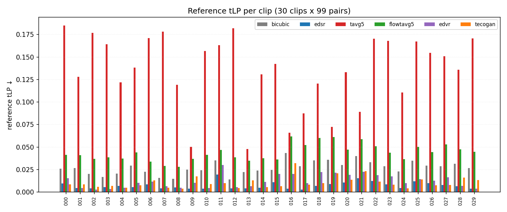
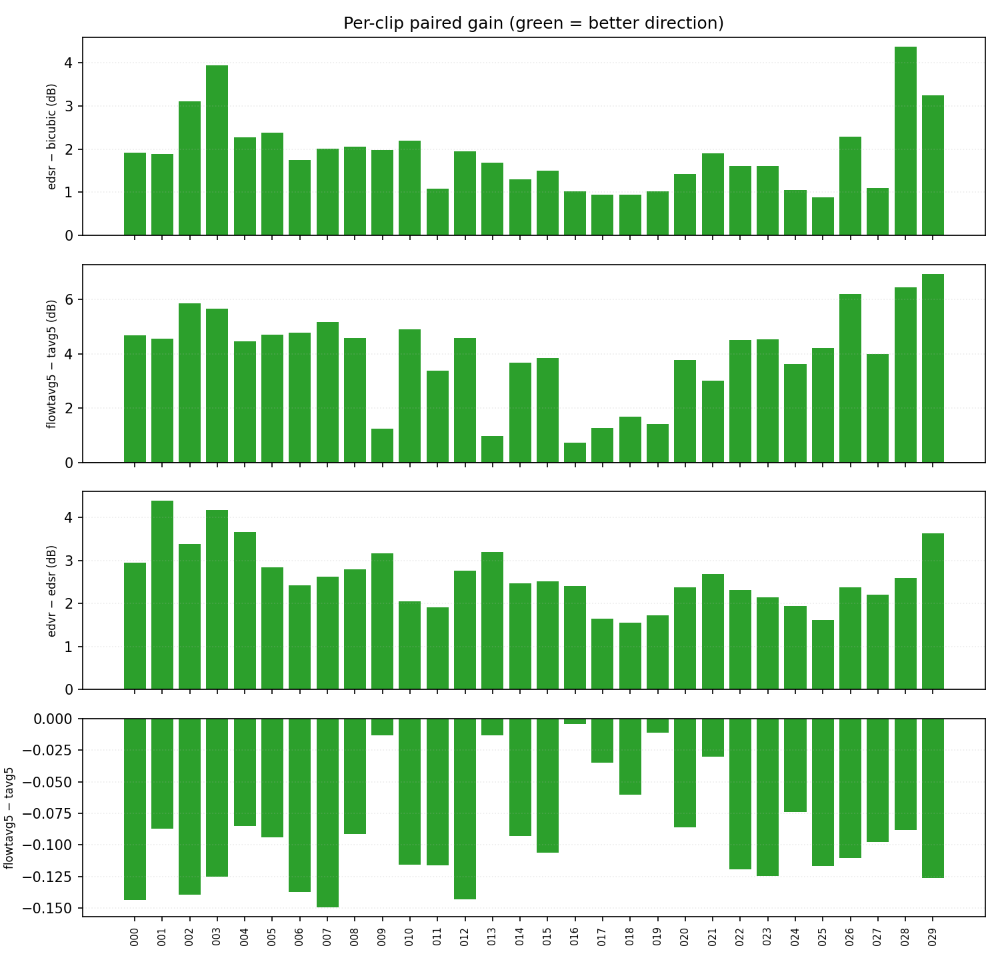
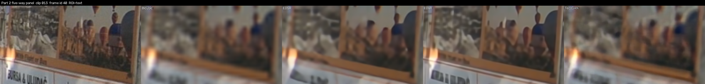

# Clean-Domain Benchmarks & Diagnostic Studies

This document consolidates the unified 12-method ×4 VSR benchmark on REDS-val, the Vimeo-90K cross-weight study, and all six diagnostic analyses (motion stratification, optical-flow alignment diagnostics, degradation-mismatch refutation, EDVR neighbor utilization, speed/VRAM profiling, and qualitative ROI evidence).

---

## 1. Unified 12-Method Benchmark on REDS-val (30 clips × 100 frames)

Evaluated via `experiments/02_sota_benchmarks/full_eval.py` and `fid_full.py` under identical `evalkit/` conventions. Raw per-clip JSONs reside in `results/02_sota_benchmarks/full_metrics/`.

| Method | PSNR ↑ | SSIM ↑ | LPIPS ↓ | Formal tLP ↓ | Flow-warp LPIPS ↓ | FID ↓ |
|---|---:|---:|---:|---:|---:|---:|
| Bicubic | 26.403 | 0.7384 | 0.4835 | 0.0270 | 0.0519 | 41.41 |
| Lanczos | 26.546 | 0.7441 | 0.4861 | 0.0281 | 0.0507 | 36.33 |
| Bicubic + USM | 26.642 | 0.7517 | 0.4398 | 0.0159 | 0.0642 | 35.62 |
| **EDSR ×4 (DIV2K)** | 28.284 | 0.8067 | 0.3087 | **0.0072** | 0.0811 | 16.56 |
| 3-Frame Avg (unaligned) | 23.203 | 0.6374 | 0.5595 | 0.0895 | 0.1017 | 65.26 |
| 5-Frame Avg (unaligned) | 21.852 | 0.5903 | 0.6052 | 0.1351 | 0.0893 | 97.15 |
| 5-Frame Avg + USM | 21.960 | 0.5983 | 0.5590 | 0.1274 | 0.1006 | 92.15 |
| 3-Frame Flow-Aligned | 26.132 | 0.7286 | 0.4993 | 0.0387 | 0.0281 | 46.12 |
| 5-Frame Flow-Aligned | 25.834 | 0.7195 | 0.5096 | 0.0437 | **0.0236** | 48.67 |
| 5-Frame Flow-Aligned + USM | 26.164 | 0.7364 | 0.4692 | 0.0349 | 0.0276 | 43.62 |
| **EDVR-L ×4 (REDS)** | **30.904** | **0.8789** | **0.2039** | 0.0123 | 0.0647 | **6.31** |
| **TecoGAN ×4** | 25.843 | 0.7187 | 0.3337 | 0.0106 | 0.0800 | 40.65 |

### 1.1 Paired Contrasts & Per-Clip Win Rates

| Contrast | ΔPSNR | ΔSSIM | ΔLPIPS | ΔtLP | Per-Clip Wins (PSNR / LPIPS / tLP) |
|---|---:|---:|---:|---:|---|
| EDSR − Bicubic | +1.881 | +0.0683 | −0.1747 | −0.0198 | **30/30** / **30/30** / **30/30** |
| `tavg3` − Bicubic | −3.200 | −0.1010 | +0.0760 | +0.0625 | — |
| `tavg5` − Bicubic | −4.552 | −0.1481 | +0.1217 | +0.1081 | — |
| `tavg3` − `tavg5` | +1.352 | — | — | −0.0456 | Naive averaging worsens monotonically with window size |
| `flowtavg5` − `tavg5` | **+3.983** | +0.1292 | −0.0955 | −0.0913 | **30/30** / **30/30** / **30/30** (median `+4.49 dB`) |
| `flowtavg5` − `flowtavg3` | −0.298 | — | — | +0.0050 | Flow alignment nearly eliminates multi-frame ghosting |
| Bicubic+USM − Bicubic | +0.239 | +0.0134 | −0.0437 | −0.0110 | Improves spatial & tLP; worsens Flow-warp LPIPS |
| `flowtavg5`+USM − `flowtavg5` | +0.330 | +0.0169 | −0.0404 | −0.0089 | Same split effect as above |
| **EDVR − EDSR** | **+2.620** | +0.0722 | −0.1048 | **+0.0050** | **30/30** / **30/30** / **4/30** (EDVR is sharper, higher $d_{\text{SR}}$ gap) |
| **TecoGAN − Bicubic** | −0.560 | −0.0197 | −0.1498 | −0.0164 | **0/30** / **30/30** / **30/30** |

**Key takeaway:** Part 2 exposes a **multi-axis trade-off, not a simple fidelity-vs-perception dichotomy**. TecoGAN loses to EDVR not only on PSNR (`−5.06 dB`) and FID (`40.65` vs `6.31`), but also on LPIPS (`0.3337` vs `0.2039`). Meanwhile, EDVR beats EDSR on 30/30 clips in PSNR and LPIPS yet loses on 26/30 clips in formal tLP.

  
  

---

## 2. Vimeo-90K Cross-Weight Study (7,824 septuplets)

Each Vimeo-90K test sequence provides GT only for the center frame (`im4.png`), so reference-based tLP is structurally undefined (`null`). Results (`results/02_sota_benchmarks/diagnostics/vimeo/vimeo_part2.json`):

| Method | PSNR ↑ | SSIM ↑ | LPIPS ↓ |
|---|---:|---:|---:|
| Bicubic | 30.150 | 0.86186 | 0.2905 |
| Lanczos | 30.398 | 0.86629 | 0.2884 |
| Bicubic + USM | 30.409 | 0.86705 | 0.2532 |
| EDSR ×4 (DIV2K) | 33.495 | 0.91578 | 0.1342 |
| EDVR-L ×4 (**REDS weights**, `num_frame=5`) | 24.494 | 0.77478 | 0.1452 |
| **EDVR-L ×4 (Vimeo weights, `num_frame=7`)** | **36.201** | **0.94735** | **0.0910** |

**Critical discovery:** Weight-domain matching creates an **11.71 dB swing** (`24.494` vs `36.201 dB`) on the exact same inputs—vastly larger than architectural differences. Furthermore, the two official BasicSR EDVR-L checkpoints have **different input architectures**: the REDS checkpoint uses `num_frame=5` (`fusion.feat_fusion.weight` input channels `640 = 5 × 128`), while the Vimeo checkpoint uses `num_frame=7` (`896 = 7 × 128`). Our evaluation scripts infer `num_frame` directly from checkpoint tensor shapes.

---

## 3. Motion-Intensity Stratification (Fixed Tertiles)

To avoid post-hoc bias, clips are partitioned **before inspecting any model scores** using `motion(clip)` = median pixel-wise optical-flow magnitude across all adjacent LR pairs (`1/4` Farneback). The 30 REDS clips split evenly into `low`, `mid`, and `high` (10 clips each; `results/02_sota_benchmarks/diagnostics/motion/`):

| Tertile | Clips | Median Motion | Bicubic PSNR | `tavg5 − bicubic` | `flowtavg5 − tavg5` | `EDVR − EDSR` |
|---|---:|---:|---:|---:|---:|---:|
| Low | 10 | 0.29 px | 25.93 | −2.80 dB | +2.51 dB | +2.51 dB |
| Mid | 10 | 0.73 px | 25.83 | −5.07 dB | +4.49 dB | +2.90 dB |
| High | 10 | 1.04 px | 27.45 | **−5.79 dB** | **+4.94 dB** | +2.45 dB |

Spearman rank correlations across $n = 30$ clips:

| Quantity | Spearman $\rho$ | $p$-value | Interpretation |
|---|---:|---:|---|
| `tavg5 − bicubic` (PSNR) | **−0.756** | `< 0.001` | Larger motion strictly worsens naive temporal averaging |
| `tavg5 − bicubic` (tLP) | **+0.907** | `< 0.001` | Naive averaging destroys temporal fidelity under motion |
| `flowtavg5 − tavg5` (PSNR) | **+0.738** | `< 0.001` | Optical-flow alignment gain scales directly with motion |
| `flowtavg5 − tavg5` (tLP) | **−0.909** | `< 0.001` | Alignment restores temporal dynamics under motion |
| **`EDVR − EDSR` (PSNR)** | **−0.012** | **0.951** | **Refutes intuition:** EDVR's gain over EDSR is motion-invariant |

**Explanation:** Learned deformable alignment (PCD) does not derive its advantage solely from correcting large global displacements; it extracts sub-pixel multi-frame detail across both low- and high-motion scenes. Conversely, classical Farneback alignment still struggles on clips with large **independent non-global object motion** (e.g., `clip 012`, p99 non-global flow residual `2.24 px`, `flowtavg5 − bicubic = −2.178 dB`).

---

## 4. Optical-Flow Alignment Diagnostics

### 4.1 Resolution Calibration (Known 1.5 px Synthetic Shift)

| Flow Resolution | L1 Warp Residual ↓ | Runtime / Pair |
|---|---:|---:|
| 1/1 (full) | 3.773 | 356 ms |
| **1/2** | **3.769** | 80 ms |
| 1/4 (default) | 3.889 | 26–94 ms |
| 1/8 | 4.107 | 10 ms |

Thus `1/4` resolution is a principled speed-accuracy trade-off rather than strictly most accurate on synthetic shifts.

### 4.2 Forward-Backward Consistency Occlusion Mask (3 clips × 12 frames)

Using a development-only threshold (`1.44 px`, p90 on `clip 000`) with the corrected **sum** criterion `|f_fwd(p) + f_bwd(p + f_fwd(p))|` (occluded fraction `0.7%–12.9%`) evaluated untouched on `clips 004 / 011 / 019`:

| Variant | PSNR ↑ | SSIM ↑ | LPIPS ↓ | Formal tLP ↓ | Delta vs `1/4` |
|---|---:|---:|---:|---:|---|
| `1/1` | 25.639 | 0.7109 | 0.5026 | 0.04409 | −0.02 dB |
| `1/2` | **25.741** | **0.7183** | 0.4986 | 0.04104 | +0.12 dB |
| `1/4` (baseline) | 25.617 | 0.7140 | 0.5018 | 0.04094 | — |
| `1/8` | 25.388 | 0.7061 | 0.5084 | 0.04262 | −0.23 dB |
| **FB Mask @ `1/4`** | 25.687 | 0.7164 | **0.4964** | **0.03789** | **+0.07 dB, tLP −7.5%** |

FB occlusion masking is the only alignment modification that **simultaneously improves all four metrics** (cost: ~+50% flow runtime for the reverse pass). Out-of-frame border-replicated pixels account for only `0.21%–1.66%` across these clips.

---

## 5. Refuting the TecoGAN "Degradation Mismatch" & "Training Domain" Hypotheses

On REDS-val, EDVR-L leads TecoGAN by **+5.061 dB** (`30.904` vs `25.843 dB`). We systematically tested and ruled out every confounding explanation (`results/02_sota_benchmarks/diagnostics/degradation/` & `edvr_vimeo_ab/`):

### 5.1 Anti-Aliased Downsampling Kernel Verification

A subtle pitfall was uncovered during testing: REDS `val_sharp_bicubic` uses **MATLAB `imresize`-style anti-aliased bicubic downsampling (`a = −0.5`)**, whereas OpenCV `cv2.INTER_CUBIC` uses `a = −0.75` **without anti-aliasing kernel widening**. Using `cv2.INTER_CUBIC` introduces severe spectral aliasing (`24.253` vs `25.784 dB` bicubic PSNR, only `11.2%` exact pixel matches) and creates spurious `+6.2 / +7.5 dB` sensitivity artifacts. Our corrected `down_bicubic()` matches `val_sharp_bicubic` with **89.18% bit-exact pixels** (MAE `0.109/255`, identical `25.784 dB`).

### 5.2 Controlled Gaussian ($\sigma = 1.5$) vs Anti-Aliased Bicubic Test (5 clips × 25 frames)

| Method | Gaussian ($\sigma=1.5$) PSNR | Anti-Aliased Bicubic PSNR | $\Delta(\text{gauss} - \text{bicubic})$ |
|---|---:|---:|---:|
| Bicubic | 25.633 | 25.835 | −0.202 dB |
| EDSR | 27.112 | 27.491 | −0.379 dB |
| EDVR-L | 28.450 | 29.954 | −1.503 dB |
| **TecoGAN** | 25.063 | 25.324 | **−0.260 dB** |

Switching to TecoGAN's own Gaussian $\sigma=1.5$ degradation does **not** help TecoGAN overtake any method; it shifts by only `−0.26 dB`.

### 5.3 Full Attribution of the 5.061 dB EDVR–TecoGAN Gap

| Candidate Confound | Controlled Measurement | Verdict |
|---|---|---|
| Degradation kernel mismatch | TecoGAN $\Delta = -0.260\text{ dB}$ | **Ruled out** |
| Sub-pixel grid shift | `--shift 0.375` already applied (`+2.664 dB` recovered) | **Accounted for** |
| Residual translation | Phase-correlation ~`+0.7` HR px; shifting degrades PSNR by `0.53–0.66 dB` | **Ruled out** |
| Color offset | Mean RGB bias `−0.4/255`; correction changes PSNR `25.354 → 25.354 dB` | **Ruled out** |
| Training domain (Vimeo vs REDS) | EDVR-Vimeo (`30.350 dB`) vs EDVR-REDS (`30.904 dB`) on all 30 clips (30/30 negative) | Explains only **0.554 dB** |
| **Model capacity & GAN objective** | Remaining **~4.5 dB** (112×64 patch training + adversarial objective) | **Primary cause** |

---

## 6. EDVR Multi-Frame Neighbor Utilization Ablation

Replacing the 5-frame sliding window with **5 identical copies of the center frame** (`results/02_sota_benchmarks/diagnostics/edvr_neighbor/neighbor.json`):

| Clip | Motion Group | Motion | Normal 5-Frame PSNR | Center Repeated ×5 | $\Delta$ |
|---|---|---:|---:|---:|---:|
| 013 | Low | 0.10 px | 29.235 | 26.399 | −2.835 dB |
| 016 | Low | 0.11 px | 26.366 | 24.058 | −2.308 dB |
| 007 | High | 1.08 px | 31.084 | 28.503 | −2.581 dB |
| 006 | High | 1.13 px | 32.167 | 29.808 | −2.359 dB |
| 012 | High | 1.00 px | 31.202 | 28.481 | −2.721 dB |
| 003 | Mid | 0.92 px | 35.188 | 31.421 | −3.767 dB |
| **Mean** | — | — | — | — | **−2.762 dB (6/6 negative)** |

- **Caveat:** Repeating the center frame alters input distribution (zero inter-frame motion), so this measures total neighbor-information value rather than isolating PCD vs TSA individually.
- **Boundary padding check:** Dropping the first and last 2 clamped frames changes PSNR by only `+0.008` to `+0.041 dB` (`< 0.05 dB`, negligible).

---

## 7. Runtime & Peak VRAM Profiling

Measured on a shared NVIDIA RTX A6000 (`fp32`, `320×180 → 1280×720`, 100 frames, `torch.cuda.synchronize()`, 1 warmup). Because shared-host contention caused up to `6×` cross-run variance, we report the **minimum across three independent runs** alongside `run_spread_ratio` (`results/02_sota_benchmarks/diagnostics/bench/merged.json`):

| Method | ms / frame (min) | FPS | Peak VRAM | Cross-Run Spread |
|---|---:|---:|---:|---:|
| Bicubic | 2.3 | 439 | — | 1.1× |
| Lanczos | 7.4 | 136 | — | 1.2× |
| Bicubic + USM | 20.8 | 48 | — | 1.1× |
| 3-Frame Avg | 36.1 | 28 | — | 8.0× ⚠ |
| 5-Frame Avg | 41.4 | 24 | — | 13.8× ⚠ |
| Flow-Aligned 5-Frame (cached flow) | 98.1 | 10.2 | — | 12.5× ⚠ |
| Flow-Aligned 5-Frame (recomputed flow) | 419.4 | 2.4 | — | 2.0× ⚠ |
| **EDSR ×4 (batch 4)** | **85.5** | 11.7 | 2,048 MiB | 4.1× ⚠ |
| **EDVR-L ×4 (batch 1)** | **548.6** | 1.8 | 1,211 MiB | 1.4× |

- Optical flow estimation (`9.94 s` / 100 frames × 2 directions) dominates warping/blending (`4.41 s`), explaining the `4.3×` speedup when reusing cached flow.
- Relative ratios are stable across all runs: Bicubic is ~`37×` faster than EDSR, and EDSR is ~`6.4×` faster than EDVR-L. Batching EDSR (`bs = 1, 2, 4, 8`) yields flat latency (`58.7–68.3 ms/frame`) while scaling VRAM linearly (`1.6 → 5.0 GiB`).

---

## 8. Qualitative Visual Evidence

Automated ROI heuristics (`max |Laplacian|`) select dense foliage rather than semantic signage on clips without text (`004`/`011`). Final qualitative panels therefore use **`clip 013`** (street scene with genuine menu signage and poster text) with fixed coordinates frozen in `results/02_sota_benchmarks/diagnostics/qual/qual_013.json`. All detail panels and 4-frame consecutive strips are archived in `results/figures/benchmarks/qualitative/`.

  

