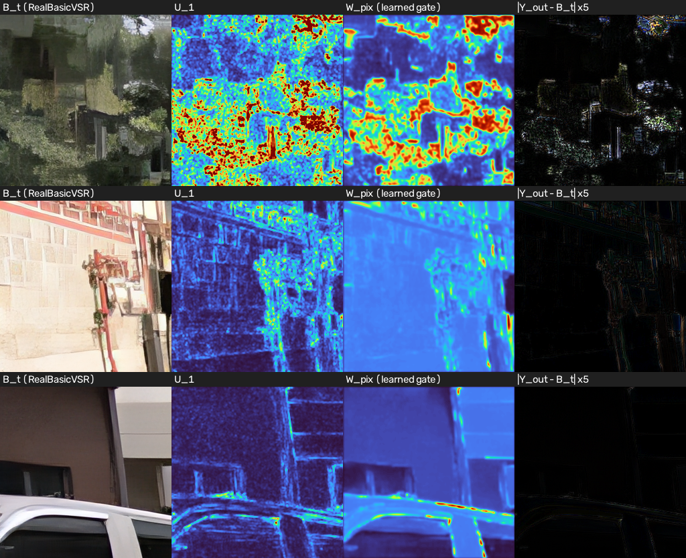

# Negative Results, Refuted Hypotheses, and Controlled Ablations

Scientific rigor requires reporting what **failed** with the same precision as what succeeded. This document compiles eight controlled negative or null findings from this project—each backed by frozen quantitative records—that directly shaped our final pixel-space design.

---

## Summary Index

| # | Hypothesis Tested | Domain | Verdict | Archive / Evidence |
|---|---|---|---|---|
| 1 | EDVR internal attention (`U3_attn`) proxies pixel uncertainty | REDS bicubic | **Refuted** ($\rho = -0.038$) | `results/04_uncertainty_and_ft/uncertainty/uncertainty.json` |
| 2 | Uncertainty routing to Real-ESRGAN improves clean bicubic VSR | REDS bicubic | **Refuted** (monotonic drop on all metrics) | `results/04_uncertainty_and_ft/uncertainty/route_*.json` |
| 3 | Small-budget pixel-space residual diffusion (`U-TRD`) beats deterministic residual | REDS bicubic | **Negative** (`−4.38` to `−5.69 dB`) | `archive/utrd/RESULTS_PROTO1.md` |
| 4 | Output-level fusion with frozen StableSR improves EDVR | REDS bicubic | **Negative** (best fixed `+0.00045 dB`, oracle `+0.020 dB`) | `archive/stablesr_fusion/PROBE_CONCLUSION.md` |
| 5 | External diffusion priors help clean bicubic / zero-shot chaining helps REDS-Real | REDS / REDS-Real | **Refuted** (`+152–197%` LPIPS; `4.4×` $E_{\text{warp}}$ blowup) | `results/05_generative_priors/summary/` |
| 6 | Zero-init SD 2.1 latent residual LoRA + uncertainty gate (**M2 Stage A**) | REDS-Real | **No-Go (5/5 arms)** — 8× VAE error floor + cyan cast | `archive/m2_stageA_latent_lora/RESULTS_M2.md` |
| 7 | Training-time $U_1$ spatial loss weighting (`B2_uncertain`) beats uniform (`B1`) | REDS-Real | **Negative** (underperforms on PSNR, LPIPS, $E_{\text{warp}}$) | `results/06_realworld_pixel_ft/metrics/regions.json` |
| 8 | Spatial structure in `blend_sqrt` drives the 4-metric win over RealBasicVSR | REDS-Real & MVSR4x | **Refuted** (constant $\alpha \in [0.3, 0.7]$ also wins all 4 and beats `blend_sqrt` on PSNR/LPIPS) | `results/06_realworld_pixel_ft/metrics/blend_const_*/` |

---

## Detailed Findings

### 1. Internal Attention Weights Are Not Uncertainty (`U3_attn`)

- **Hypothesis:** EDVR's temporal-spatial attention correlation weights (`1 - mean_t corr_prob`) are free during inference and should highlight unreliable regions.
- **Evidence:** On REDS-val, `U3_attn` exhibits Spearman $\rho = -0.038$ with ground-truth error, nearly flat decile calibration, and `13.1%` error capture at top-10% (random baseline `10.0%`), compared to `U2` model disagreement (`ρ = +0.404`, `24.3%`) and blind Laplacian (`U4`, `ρ = +0.399`, `18.1%`).
- **Takeaway:** Attention weights reflect feature alignment similarity, not predictive error; they cannot substitute for epistemic/disagreement uncertainty.

### 2. Clean-Domain Routing Fails Under Target-Branch Dominance

- **Hypothesis:** Routing high-uncertainty pixels from a fidelity backbone (BasicVSR++) to a generative model (Real-ESRGAN) improves perceptual quality while preserving stability.
- **Evidence (clip `000`, 100 frames):**

| Configuration | PSNR ↑ | LPIPS ↓ | Flow-warp LPIPS ↓ |
|---|---:|---:|---:|
| BasicVSR++ | **31.418** | **0.1645** | **0.0747** |
| Real-ESRGAN | 23.506 | 0.2927 | 0.0929 |
| Hard route (`q = 0.99`) | 27.803 | 0.1681 | 0.0888 |
| Hard route (`q = 0.90`) | 24.575 | 0.1924 | 0.1037 |
| Best soft fusion (`α=0.15, g=0.98`) | 31.408 | 0.1647 | — |

- **Mechanism:** Routing requires **complementary error profiles**. On synthetic bicubic inputs, a real-degradation GAN is strictly dominated even in textured regions (`−7.9 dB` PSNR, `+0.13` LPIPS), so any mixing weight is Pareto-inferior.

### 3. U-TRD: Small-Budget Pixel-Space Residual Diffusion (`archive/utrd/`)

- **Setup:** Frozen EDVR + lightweight residual U-Net trained for 1,500 steps (batch 8, DISTS `0.01`, no GAN) comparing deterministic residual, uniform-noise 4-step diffusion, and uncertainty-scaled-noise 4-step diffusion.
- **Evidence (`archive/utrd/RESULTS_PROTO1.md`):**

| Prototype | PSNR ↑ | LPIPS ↓ | Relative to Frozen EDVR |
|---|---:|---:|---|
| Frozen EDVR | **32.4095** | 0.15138 | Baseline |
| Deterministic residual | 32.3892 | **0.14957** | LPIPS −1.2% |
| Uniform-noise diffusion | 28.0344 | 0.26446 | PSNR −4.38 dB |
| Uncertainty-noise diffusion | 26.7161 | 0.22065 | PSNR −5.69 dB |

- **Takeaway (scoped to small budget):** Under small-budget pixel-space training, 4-step residual diffusion trails a capacity-matched deterministic residual network by `> 4.3 dB`, and uncertainty-scaled noise does not outperform uniform noise.

### 4. StableSR Output-Level Fusion Probe (`archive/stablesr_fusion/`)

- **Evidence (`archive/stablesr_fusion/PROBE_CONCLUSION.md`):** Fusing frozen single-frame StableSR outputs with EDVR on REDS bicubic yields a maximum fixed-blend gain of `+0.00045 dB` and a per-pixel oracle upper bound of only `+0.020 dB`. Terminated immediately.

### 5. Zero-Shot Chaining `RealBasicVSR → OSEDiff` Destroys Temporal Stability

- **Hypothesis:** Using RealBasicVSR to clean real-world degradations and feeding its output to OSEDiff might combine RealBasicVSR's stability with OSEDiff's perceptual sharpness.
- **Evidence (REDS-Real c9, 270 frames):** Compared to standalone RealBasicVSR, zero-shot chaining drops PSNR from `20.822` to `19.583 dB` (`−1.24 dB`), worsens LPIPS (`0.4881 → 0.5057`), and inflates $E_{\text{warp}}$ from `6.346` to `8.352`—expanding the temporal jitter gap relative to GT (`5.757`) from `+0.589` to `+2.595` (**4.4× worse**).

### 6. M2 Stage A: SD 2.1 8× VAE Bottleneck & Cyan Block Artifact (`archive/m2_stageA_latent_lora/`)

- **Hypothesis:** Adding a zero-initialized latent residual LoRA + uncertainty gate on top of RealBasicVSR using frozen SD 2.1 avoids zero-shot double-sharpening.
- **Rigorous Bug Audit Before Declaring No-Go:** An audit uncovered and fixed **7 implementation bugs** (1: `meshgrid(..., indexing="ij")` transposed warp 90°; 2: crop guard `W > 64` cropped training flow to top-left 64×64; 3: isotropic flow scaling `h/flow_w`; 4: inverted gate `1 - u1`; 5: gate regularizer anchored to `0.5` instead of `u1`; 6: detached RaGAN gradients; 7: first-frame self-difference saturating `u1 = 1.0`).
- **Evidence (REDS-Real dev clips `000/002/009`, 27 frames; Go threshold LPIPS `≤ 0.4140`):**

| Pilot Arm | Key Configuration | PSNR ↑ | ΔPSNR | LPIPS ↓ | ΔLPIPS | $E_{\text{warp}}$ ↓ | Verdict |
|---|---|---:|---:|---:|---:|---:|---|
| RealBasicVSR | Baseline | 21.5206 | — | 0.43579 | — | 5.1537 | Baseline |
| `P0_const` | Fresh LoRA r16, const gate `0.5` | 21.5999 | +0.079 | 0.45738 | +4.9% | 5.0602 | No-Go |
| `P1_fixed_U1` | Fresh LoRA r16, fixed $U_1$ *(inverted)* | 20.9098 | −0.611 | 0.44341 | +1.7% | 6.7478 | No-Go |
| `P2_learn_M` | Fresh LoRA r16, learned gate | 21.6234 | +0.103 | 0.46567 | +6.9% | 5.4463 | No-Go |
| `P3_from_ose` | OSEDiff LoRA init, raw residual | 21.5951 | +0.075 | 0.46925 | +7.7% | 5.5167 | No-Go |
| **`P4_perc_fix`** | **All 7 bugs fixed** + `neg_raw` + RaGAN | 20.5696 | −0.951 | 0.46743 | +7.3% | 6.8517 | **No-Go** |

- **Two Structural Root Causes:**
  1. **8× Lossy VAE Round-Trip Error Floor:** Encoding and decoding through SD 2.1's VAE incurs mean error `0.045` (`~11.5/255`, max `0.81`), on the exact same order as RealBasicVSR's remaining pixel error (`10–24/255`). Every latent residual pays this fixed distortion tax before making any correction.
  2. **`neg_raw` Cyan Block Artifact:** Negating a noise-prediction LoRA (`osediff.pkl`) amplifies its systematic channel bias into a red-channel deficit (`R: −10.81`, `G: −3.37`, `B: −1.64` on clip `016` frame `22`; `7.17%` of pixels exceed `|d| > 40`), manifesting as 8×8 cyan patches specifically in high-$U_1$ textured regions (`gate_vis_p4.png`).

  

- **Strategic Impact:** Directly motivated abandoning 8× latent residual grafting and pivoting to pixel-space multi-frame fine-tuning (`experiments/06_realworld_pixel_ft/`), which immediately flipped LPIPS from `+7.3%` worse to **`−6.3%` better** on 30 clips.

### 7. Training-Time Uncertainty Loss Weighting (`B2_uncertain` vs `B1_uniform`)

- **Mechanism:** Under strict batch mean alignment (`|mean diff| < 3e-8`), reducing adversarial weight in flat regions forces textured-region adversarial weight up to `1.0`. Because textures are already sharp, pushing GAN weight higher induces inter-frame jitter (`textured E_warp 11.428` vs `10.971`), offsetting the tiny `1.8%` flat-region HF reduction.

### 8. Spatial Structure in `blend_sqrt` Is Not Why Blending Wins All 4 Metrics

- **Evidence:** Adding 6 constant-weight controls (`const_sqrt`, `const_05`, `const_a{300,400,600,700}`) proved that **any fixed mixing ratio $\alpha \in [0.3, 0.7]$ beats RealBasicVSR on all 4 metrics simultaneously**, and `const_a600` beats `blend_sqrt` on PSNR (`20.912` vs `20.835`), LPIPS (`0.4562` vs `0.4644`), and DISTS (`0.1805` vs `0.1806`). The global mean of $\sqrt{U_1}$ is `0.5079`, flattening its spatial contrast; pixel-wise, $U_1$'s spatial map lowers textured-region PSNR by `−0.29 dB` relative to `const_sqrt`, and helps reliably only on **DISTS** (`27/30` clips). The identical pattern reproduces cross-domain on **MVSR4x** (`const_0.5` beats `blend_sqrt` on PSNR, LPIPS, and DISTS).
