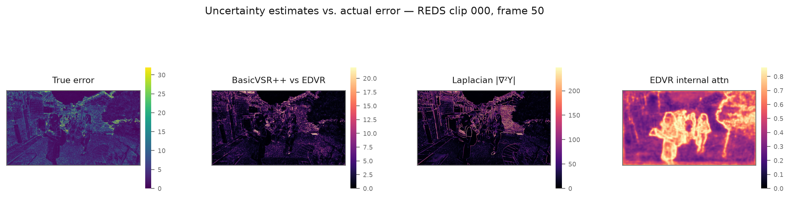
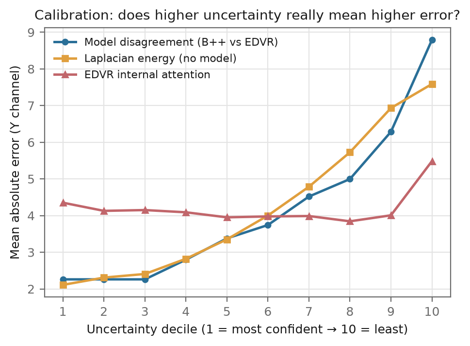
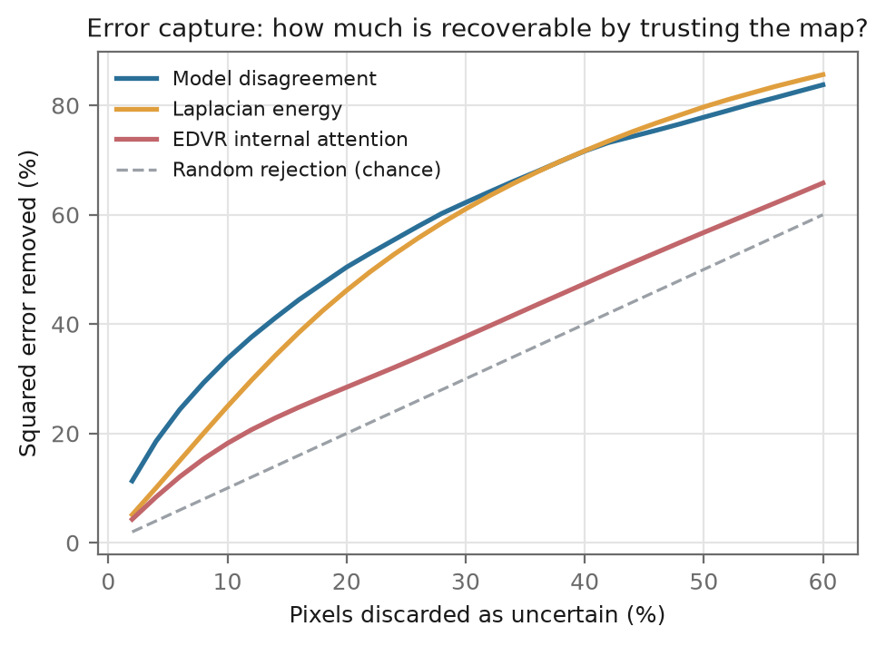
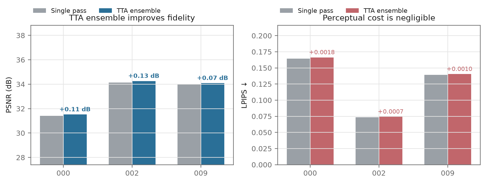
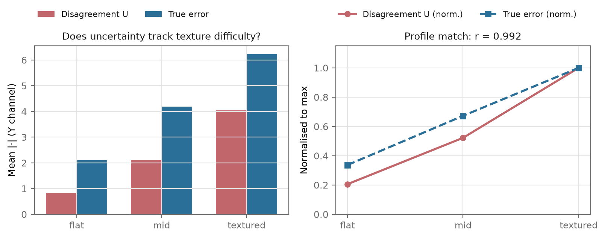

# Uncertainty-Aware & Real-World Video Super-Resolution

This document presents the complete research progression of Part 3 (Direction C): from pixel-level uncertainty calibration and clean-domain perceptual fine-tuning, to the five-dataset **Degradation-Intensity Law**, to our final **6.29M-parameter pixel-space real-world fine-tuning method (`UA-RealBasicVSR`)** and its honest blending and cross-domain ablations.

---

## 1. Pixel-Level Uncertainty Calibration (Clean Domain)

Before designing any routing mechanism, we audited whether pixel-level uncertainty can reliably predict where VSR models fail. Four uncertainty estimators were evaluated (`experiments/04_uncertainty_and_ft/uncertainty/`, metrics in `results/04_uncertainty_and_ft/uncertainty/`):

| Estimator | Definition | Extra Cost | Spearman $\rho$ (vs GT Error) | Error Capture @10% | Selective PSNR ↑ |
|---|---|---|---:|---:|---:|
| **`U1` (Flip-TTA Spread)** | $\|Y(x) - \text{flip}(Y(\text{flip}(x)))\|$ | 1× forward | `0.36–0.46` | — | — |
| **`U2` (Model Disagreement)** | $\|Y_{\text{BasicVSR++}} - Y_{\text{EDVR}}\|$ | 1× forward | **+0.404** | **24.3%** | **32.84 dB** |
| **`U3` (EDVR Temporal Attention)** | $1 - \text{mean}_t(\text{corr\_prob})$ | 0 (free) | **−0.038** | 13.1% | 31.79 dB |
| **`U4` (Laplacian Blind Baseline)** | $\|\nabla^2 Y\|$ | 0 (model-free) | +0.399 | 18.1% | 32.17 dB |
| *(Random Baseline)* | — | — | 0.000 | 10.0% | — |

**Key findings:**
1. **Free internal attention (`U3`) fails as an uncertainty estimator** ($\rho = -0.038$, barely above random chance).
2. **`U2` and blind `U4` both calibrate strongly** ($\rho \approx 0.40$), and across semantic variance strata (`flat` / `mid` / `textured` on clip `000`), mean `U2` tracks mean true error with **$r = 0.992$** (top-10% overlap `32.2%`, `3.2×` random).
3. **Flip-TTA (`U1`) is a genuine free lunch on clean VSR:** averaging horizontally flipped BasicVSR++ predictions improves PSNR on 3/3 clips (`+0.115 / +0.135 / +0.074 dB`) with negligible LPIPS cost (`< 0.002`) while yielding calibrated uncertainty (`U1`) from a single model.
4. **Why routing fails on clean bicubic:** Because `U4` alone predicts error nearly as well as `U2`, error concentrates on intrinsic high-frequency texture where Real-ESRGAN is strictly dominated (`23.506` vs `31.418 dB`, `−7.9 dB`). Both hard routing and soft residual fusion degrade all metrics monotonically (detailed in [`NEGATIVE_RESULTS_AND_ABLATIONS.md`](NEGATIVE_RESULTS_AND_ABLATIONS.md)).

  
  

  
  
  

---

## 2. Clean-Domain Positive Deliverable: EDVR Perceptual Fine-Tuning

When the restoration backbone dominates external priors in-domain, improving perceptual quality requires optimizing the backbone directly. Fine-tuning **EDVR-L ×4** with `Charbonnier (1.0) + DISTS (0.03) + SN-UNet RaGAN (0.001)` for 900 steps (`lr = 3e-5`, batch 8, LR crop `64×64`; `configs/edvr_perceptual_ft.json`) across all 30 REDS-val clips:

| Metric | Baseline EDVR-L | Fine-Tuned EDVR-L (`FT-EDVR`) | Delta | Per-Clip Win Rate |
|---|---:|---:|---:|---:|
| **PSNR ↑** | **30.9042** | 30.5231 | −0.381 dB | 0/30 |
| **LPIPS ↓** (independent) | 0.2039 | **0.1402** | **−31.2%** | **30/30** |
| **tLP ↓** (independent) | 0.0123 | **0.0077** | **−36.6%** | **29/30** |
| DISTS ↓ *(training loss)* | 0.0870 | 0.0433 | −50.2% | 30/30 |

**Mechanistic diagnostics (`results/04_uncertainty_and_ft/edvr_finetune/runs_metrics/`):**
- **Texture synthesis vs recovery:** High-frequency energy ratio (`hf_ratio`) rises toward GT (`0.539 → 0.611` on clip `000` textures) while pixel-wise high-frequency correlation (`hf_corr`) slightly drops (`0.533 → 0.507`), confirming genuine perceptual texture synthesis rather than a global sharpening filter (residual linear-filter fit $R^2 = 0.004$).
- **Role of lightweight adversarial term (`0.001`):** Suppresses flat-region noise energy (`0.593 → 0.538`) compared to DISTS-only fine-tuning while further lowering LPIPS.
- **Scope boundary:** Because training (`train_sample`) and validation (`val_sharp`) share the REDS bicubic domain, this gain is **in-domain** and does not generalize to severe real-world degradation (see §3).

---

## 3. The Degradation-Intensity Law (5 Datasets × 10+ Models)

Evaluating external generative priors (**OSEDiff**, **SUPIR v0F**, **DOVE 5B**) alongside regression backbones across five datasets reveals a clean unifying rule: **whether generative priors help is governed by effective degradation severity, not dataset provenance.**

### 3.1 Clean REDS Bicubic (Paired GT)

On textured patches where `FT-EDVR` achieves LPIPS `0.0659`, all three real-world generative priors fail decisively by hallucinating mismatched textures:
- **OSEDiff:** `0.1660` (`+151.8%`, PSNR `22.93 dB`)
- **SUPIR v0F:** `0.1955` (`+196.6%`, PSNR `26.15 dB`)
- **DOVE 5B:** `0.1963` (`+197.2%`, PSNR `25.34 dB`)

### 3.2 RealVSR — Paired Real ~2× Degradation (50 clips × 5 frames)

RealVSR LQ and GT share the same pixel grid (`512×1024`) with measured effective bandwidth ratio ~`2×` (LQ high-frequency energy `0.316%` vs `GT↓2` `0.298%` vs `GT↓4` `0.065%`). Adapting LQ via `×4` downsampling for a unified `×4` protocol (note: not directly comparable to official `upscale=1` tables):

| Method | PSNR ↑ | SSIM ↑ | LPIPS ↓ | DISTS ↓ | tLP ↓ |
|---|---:|---:|---:|---:|---:|
| EDVR-L | **23.036** | **0.7590** | 0.2404 | 0.1315 | 0.0128 |
| FT-EDVR | 22.871 | 0.7452 | **0.1979** | **0.0944** | **0.0094** |
| Bicubic ×4 | 22.147 | 0.6480 | 0.4997 | 0.2118 | 0.0287 |
| SUPIR v0F | 22.082 | 0.6470 | 0.3347 | 0.1774 | 0.0111 |
| DOVE 5B | 21.577 | 0.6666 | 0.2215 | 0.1118 | 0.0177 |
| OSEDiff | 20.049 | 0.5875 | 0.2710 | 0.1397 | 0.0143 |

Under mild ~2× degradation, regression models retain superiority; DOVE narrows the perceptual gap (`+11.9%` LPIPS vs `FT-EDVR`), while OSEDiff drops `2.1 dB` below bicubic.

### 3.3 MVSR4x — Paired Real Dual-Camera True ×4 (15 clips × 5 frames)

Wide (`13 mm`) vs telephoto (`90 mm`) real dual-camera pairs (`1024×1024`), verified as true `×4` bandwidth (`wide` high-frequency energy `0.033%` vs `tele↓4` `0.029%`):

| Method | PSNR ↑ | SSIM ↑ | LPIPS ↓ | DISTS ↓ | tLP ↓ |
|---|---:|---:|---:|---:|---:|
| Bicubic ×4 | **23.649** | **0.7400** | 0.4789 | 0.3128 | 0.0250 |
| FT-EDVR | 23.548 | 0.7368 | 0.4598 | 0.2889 | 0.0258 |
| EDVR-L | 23.282 | 0.7294 | 0.4832 | 0.3004 | 0.0323 |
| **DOVE 5B** *(12/15 clips)* | 21.758 | 0.6905 | **0.3670** | **0.2193** | **0.0158** |
| OSEDiff | 21.159 | 0.6863 | 0.4114 | 0.2551 | 0.0290 |

Here the conclusion **reverses**: clean-domain EDVR falls below bicubic (`−0.37 dB`), while DOVE leads LPIPS (`−23.4%`), DISTS (`−29.9%`), and tLP (`−36.7%`).

### 3.4 REDS-Real — Paired 2nd-Order Real-World Degradation (30 clips × 9 frames)

Constructed by applying RealBasicVSR's two-pass degradation pipeline (blur → random resize → Gaussian/Poisson noise → JPEG → video compression) to clean REDS-val GT and downsampling to `GT/4` (frozen manifest SHA256 `8ab95add…`; LR Laplacian energy `15.11` vs `25.64` for clean bicubic LR).

| Method | PSNR ↑ | SSIM ↑ | LPIPS ↓ | DISTS ↓ | tLP ↓ | $E_{\text{warp}}$ ↓ | $E_{\text{warp}} - \text{GT}$ |
|---|---:|---:|---:|---:|---:|---:|---:|
| Bicubic ×4 | **21.004** | 0.5019 | 0.7271 | 0.3463 | 0.0744 | **4.994** | −0.763 |
| EDVR-L | 20.916 | 0.4902 | 0.6351 | 0.3577 | 0.0630 | 5.528 | −0.229 |
| FT-EDVR | 20.862 | 0.4840 | 0.6163 | 0.3525 | 0.0631 | 5.738 | −0.019 |
| **RealBasicVSR** | 20.822 | 0.4989 | 0.4881 | 0.2282 | 0.0443 | 6.346 | +0.589 |
| DOVE 5B | 20.856 | **0.5023** | 0.5149 | 0.2392 | 0.0526 | 5.866 | +0.109 |
| OSEDiff | 19.812 | 0.4454 | **0.4771** | 0.2235 | 0.0479 | 10.251 | +4.494 |
| RealBasicVSR → OSEDiff | 19.583 | 0.4747 | 0.5057 | **0.2227** | **0.0392** | 8.352 | +2.595 |

Clean-domain EDVR drops below bicubic (`20.916` vs `21.004 dB`). **RealBasicVSR** preserves fidelity (`−0.18 dB`) while slashing LPIPS by `32.9%` and tLP by `40.5%`. Zero-shot chaining `RealBasicVSR → OSEDiff` degrades both PSNR (`−1.24 dB`) and temporal error (`+0.589 → +2.595`, **4.4× worse**).

### 3.5 No-GT Real-World Benchmarks (VideoLQ & Mobile Footage)

On official **VideoLQ** (50 clips × 5 frames, native resolution), OSEDiff leads NIQE (`4.109`) and MUSIQ (`66.85`) vs EDVR (`5.673 / 55.81`). On 6 contiguous 97-frame VideoLQ clips, **DOVE** achieves the highest DOVER technical (`−0.0715`) and aesthetic (`0.1488`) scores, followed closely by OSEDiff (`−0.0775 / 0.1480`).

---

## 4. Pixel-Space Multi-Frame Fine-Tuning (`UA-RealBasicVSR`)

After M2 Stage A proved that SD 2.1's **8× lossy VAE** incurs a `~11.5/255` round-trip error floor comparable to RealBasicVSR's residual error (see [`NEGATIVE_RESULTS_AND_ABLATIONS.md`](NEGATIVE_RESULTS_AND_ABLATIONS.md)), we eliminated the VAE entirely and fine-tuned **RealBasicVSR** end-to-end in pixel space (`models/ua_realbasicvsr.py`, `experiments/06_realworld_pixel_ft/`).

### 4.1 Architecture & Training Objective

- **Parameter Budget:** `6.29M` total (`image_cleaning` `1.48M` + `spynet` `1.44M` frozen in `eval()` mode; **`3.37M`** trainable in bidirectional `forward_resblocks`, `backward_resblocks`, `fusion`, `upsample1/2`, `conv_hr`, `conv_last`).
- **Multi-Frame End-to-End Window:** 5-frame LR crop (`96×96` → `384×384`, center-cropped to `256×256` HR); supervision applied to the **middle 3 frames (`idx = [1, 2, 3]`)** so both temporal pairs `(2 ← 1)` and `(3 ← 2)` carry gradients through both forward and backward propagation.
- **Composite Loss:**
  $$\mathcal{L}_G = \lambda_{\text{pix}} \mathcal{L}_{\text{Charb}} + \lambda_{\text{dists}} \mathcal{L}_{\text{DISTS}} + \lambda_{\text{temp}} \mathcal{L}_{\text{temp}}^{\text{occ}} + \lambda_{\text{adv}} \mathcal{L}_{\text{RaGAN}}$$
  where $\mathcal{L}_{\text{temp}}^{\text{occ}}$ uses frozen SpyNet flow with forward-backward occlusion masking (`models/warp.py`, threshold `3.0 px`), and $\mathcal{L}_{\text{RaGAN}}$ uses a per-pixel SN-UNet discriminator (`lr_G = 3e-5`, `lr_D = 1e-4`, 1,500 steps, peak VRAM `5.76 GB`).
- **8-Point Pre-Training Self-Check (`results/06_realworld_pixel_ft/selfcheck/selfcheck_rbv.json`):** Verified `max|d| = 0.0000e+00` step-0 equivalence, exact freeze audit (`3.37M` trainable), `-77%` warp residual reduction, strict `< 3e-8` batch mean alignment between uniform and uncertainty-weighted arms, stable `adv_d ≈ 0.693`, and bit-exact checkpoint resume.

### 4.2 Three Training Arms on REDS-Real (30 clips × 270 frames)

| Arm | Spatial Loss Weighting | $(\lambda_{\text{pix}}, \lambda_{\text{dists}}, \lambda_{\text{adv}}, \lambda_t)$ | PSNR ↑ | SSIM ↑ | LPIPS ↓ | DISTS ↓ | tLP ↓ | $E_{\text{warp}}$ ↓ |
|---|---|---|---:|---:|---:|---:|---:|---:|
| RealBasicVSR (step-0) | — | — | 20.8220 | 0.4989 | 0.48810 | 0.22820 | **0.0443** | **6.3458** |
| **`B1_uniform`** | Uniform (mean-aligned) | `(0.50, 0.15, 0.003, 0.30)` | 20.5826 | 0.4489 | **0.45727** | **0.16590** | 0.0564 | 6.5346 |
| `B2_uncertain` | Training-time $U_1$ (mean-aligned) | `(0.50, 0.15, 0.003, 0.30)` | 20.5458 | 0.4479 | 0.46135 | 0.16605 | 0.0558 | 6.5964 |
| `B2b_perc_boost` | Training-time $U_1$ (high perc) | `(0.35, 0.25, 0.005, 0.20)` | 20.2682 | 0.4258 | 0.45427 | 0.16091 | 0.0509 | 7.8002 |

**Regional Decomposition (`results/06_realworld_pixel_ft/metrics/regions.json`, `flat`: $u \le 0.25$, `textured`: $u \ge 0.75$):**

| Model | Region | PSNR ↑ | $E_{\text{warp}}$ ↓ | HF Energy | GT HF Energy |
|---|---|---:|---:|---:|---:|
| RealBasicVSR | flat / textured | **24.187** / 15.988 | **3.919** / 13.056 | **8.861** / 77.530 | 33.738 / 102.593 |
| **`B1_uniform`** | flat / textured | 23.786 / **16.037** | 4.266 / **10.971** | 20.580 / 84.253 | 33.738 / 102.593 |
| `B2_uncertain` | flat / textured | 23.798 / 15.944 | 4.228 / 11.428 | 20.209 / 88.638 | 33.738 / 102.593 |
| `B2b_perc_boost` | flat / textured | 23.581 / 15.583 | 4.827 / 13.780 | 24.213 / 102.600 | 33.738 / 102.593 |

**Insight:** In textured regions, `B1_uniform` improves **both** PSNR (`+0.049 dB`) and temporal consistency (`E_warp` **−16.0%**, `13.056 → 10.971`). The entire `−0.24 dB` global PSNR cost originates from elevated high-frequency energy in flat regions. Training-time $U_1$ weighting (`B2`) reduces flat HF by only `1.8%` while pushing textured GAN weight to `1.0` under strict mean alignment—worsening textured $E_{\text{warp}}$ (`11.428` vs `10.971`).

---

## 5. Inference-Time Soft Blending & Constant-Weight Ablation

Because `B1_uniform` and baseline RealBasicVSR share the exact same architecture, degradation domain, and pixel grid, output-level blending $Y = (1 - W) \odot Y_{\text{RBV}} + W \odot Y_{\text{B1}}$ introduces zero phase mismatch.

### 5.1 Uncertainty-Mapped Blending vs Constant-Weight Controls (30 clips × 270 frames)

Across all 270 frames, $U_1$ is heavily right-skewed (median `0.208`, `58.1%` of pixels $< 0.25$), while $|Y_{\text{B1}} - Y_{\text{RBV}}|$ concentrates in textures (`15.96/255` vs `4.11/255` in flat regions).

| Variant | Weight Rule $W$ | PSNR ↑ | LPIPS ↓ | DISTS ↓ | $E_{\text{warp}}$ ↓ | Beats RBV (All 4) |
|---|---|---:|---:|---:|---:|---|
| RealBasicVSR | `0` | 20.8220 | 0.48810 | 0.22820 | 6.3458 | Baseline |
| `B1_uniform` | `1` | 20.5826 | 0.45727 | **0.16590** | 6.5346 | No |
| `blend_binary` | $\mathbb{1}[U_1 \ge 0.5]$ | 20.7996 | 0.49092 | 0.20984 | 6.2052 | No |
| `blend_sq` | $U_1^2$ | 20.9006 | 0.48614 | 0.21097 | 5.8172 | No |
| `blend_norm` | $(U_1 - p_{10})/(p_{90} - p_{10})$ | 20.8374 | 0.47880 | 0.19344 | 5.7883 | No |
| `blend_raw` | $U_1$ | 20.8906 | 0.47798 | 0.19831 | 5.6370 | No |
| **`blend_sqrt`** | $\sqrt{U_1}$ *(mean 0.5079)* | 20.8352 | 0.46444 | 0.18056 | 5.6627 | **Yes** |
| `const_a300` | Fixed `0.3` | 20.9602 | 0.46990 | 0.21061 | 5.6944 | **Yes** |
| `const_a400` | Fixed `0.4` | **20.9636** | 0.46350 | 0.19947 | 5.6251 | **Yes** |
| `const_05` | Fixed `0.5` | 20.9564 | 0.45900 | 0.18927 | **5.6207** | **Yes** |
| `const_a600` | Fixed `0.6` | 20.9124 | 0.45615 | 0.18047 | 5.6854 | **Yes** |
| `const_a700` | Fixed `0.7` | 20.8586 | **0.45492** | 0.17397 | 5.8125 | **Yes** |
| `const_sqrt` | Per-frame `mean(sqrt(U1))` | 20.9434 | 0.45940 | 0.18793 | 5.6413 | **Yes** |

**Decisive attribution finding:**
1. **Beating RealBasicVSR on all 4 metrics is driven by intermediate blending strength ($\alpha \in [0.3, 0.7]$), NOT by spatial $U_1$ routing.** Every constant control from `0.3` to `0.7` wins all four metrics simultaneously.
2. Comparing `blend_sqrt` directly against mean-matched `const_sqrt` (same per-frame mean weight, spatial structure removed): `blend_sqrt` wins **0/30** clips on PSNR, **4/30** on LPIPS, **11/30** on $E_{\text{warp}}$, and **27/30** on DISTS. Regionally, `blend_sqrt` loses **−0.2945 dB** in textured regions (`15.985` vs `16.280 dB`) while gaining only `+0.0374 dB` in flat regions.
3. **Co-Primary Reporting Policy:** Because no single operating point simultaneously maximizes all four metrics, we report **`B1_uniform`** (strongest single-model perceptual scores: LPIPS `0.4573`, DISTS `0.1659`) and **`blend_sqrt`** (zero-free-parameter balanced configuration beating RBV on all 4 axes and outperforming DOVE 5B on both LPIPS and $E_{\text{warp}}$ with **1/800th the parameters**) side by side alongside the full constant-blending Pareto curve.

---

## 6. Cross-Domain Generalization Boundaries

Trained solely on 20 REDS `train_sample_sharp` clips with synthetic 2nd-order degradation, evaluated zero-shot on two completely unseen real-world datasets:

### 6.1 MVSR4x (15 clips × 5 frames, Real Dual-Camera, Paired GT)

| Method | PSNR ↑ | LPIPS ↓ | DISTS ↓ | $E_{\text{warp}}$ ↓ | Delta vs RealBasicVSR |
|---|---:|---:|---:|---:|---|
| RealBasicVSR | 22.0737 | 0.39479 | 0.24342 | **2.8558** | Baseline |
| `B1_uniform` | 22.1692 | 0.43703 | 0.24705 | 3.0395 | PSNR **+0.096 dB** / LPIPS **+10.69%** (12/15 worse) |
| `blend_sqrt` | 22.2589 | 0.39608 | 0.23667 | — | PSNR **+0.185 dB** / LPIPS +0.33% / DISTS −2.77% |
| `const_0.5` | **22.2633** | **0.39290** | **0.23501** | — | PSNR **+0.190 dB** / LPIPS −0.48% / DISTS −3.45% |

**Honest boundary:** **Fidelity generalizes positively (`+0.096` to `+0.190 dB`), whereas perceptual sharpening is in-domain specialized.** Because MVSR4x optical degradation is milder than REDS-Real's 2nd-order pipeline, `B1`'s learned high-frequency boost oversharpens (`+10.7%` LPIPS). Halving the strength via `blend_sqrt` or `const_0.5` doubles the PSNR gain and returns LPIPS to baseline (`+0.33%` / `−0.48%`), confirming the same spatial-vs-constant behavior cross-domain.

### 6.2 VideoLQ (50 clips, Real Internet Videos, No GT)

| Method | MUSIQ ↑ | HR $E_{\text{warp}}$ ↓ | Notes |
|---|---:|---:|---|
| RealBasicVSR (step-0) | 48.133 | 33.962 | Severe `−11.54` drop vs raw LR input (`59.674`) |
| **`B1_uniform`** | **59.347** | **32.882** | Recovers **+11.21 MUSIQ** and improves HR $E_{\text{warp}}$ by **−3.18%** vs RBV |
| `B2_uncertain` | 59.128 | 33.030 | Slightly trails `B1` on both axes |
| `B2b_perc_boost` | 60.830 | 33.723 | Highest MUSIQ (`+1.16` over raw input) but loses cross-domain PSNR on MVSR4x (`−0.256 dB`) |

*(Note: Raw LR input $E_{\text{warp}}$ (`29.397`) is measured at `1×` resolution and is not directly comparable to `4×` HR $E_{\text{warp}}$; see [`EVALUATION_PROTOCOL.md`](EVALUATION_PROTOCOL.md) §1.5.)*
