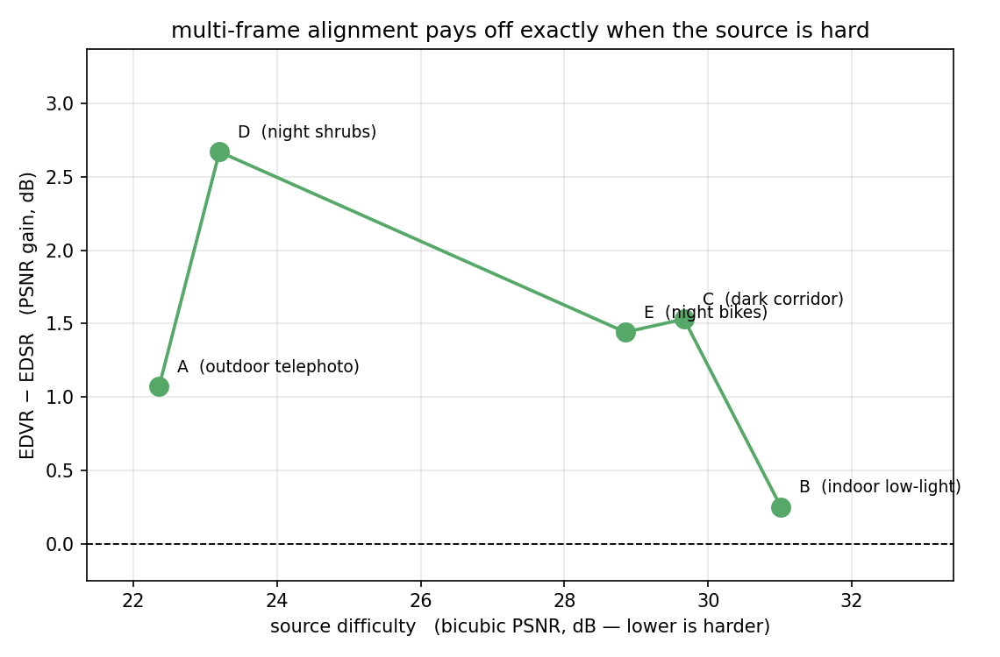
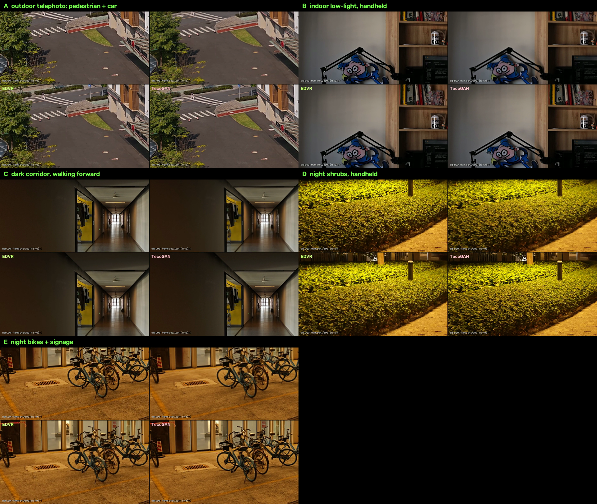

# Wild Video Study: Handheld Real-World Content Generalization

To verify generalization beyond REDS and Vimeo-90K, we recorded five original handheld smartphone videos covering diverse low-light, motion, and texture conditions, and evaluated all **12 Part 1 + Part 2 methods** across **20 non-overlapping 100-frame clips** (4 clips per source).

Raw recordings are preserved in `demos/wild_source/`, curated 2×2 demo videos in `demos/wild/`, figures in `results/figures/wild/`, metrics in `results/03_wild_video/`, and scripts in `experiments/03_wild_video/`.

---

## 1. Source Recordings

| Source | Original File | Scene Description | Total Frames | Difficulty (Bicubic PSNR) |
|---|---|---|---:|---:|
| **A** | `VID_20261116_113830.mp4` | Elevated street view: pedestrians, cars, crosswalk | 738 | **22.36 dB** (hardest) |
| **B** | `VID_20261116_114235.mp4` | Indoor low-light desk plushie | 481 | **31.01 dB** (easiest) |
| **C** | `VID_20261116_145154.mp4` | Dim corridor, walking forward (strong perspective flow) | 476 | 29.66 dB |
| **D** | `VID_20261116_212712.mp4` | Nighttime bushes, handheld camera shake | 289 | **23.20 dB** |
| **E** | `VID_20261116_212859.mp4` | Nighttime shared bicycles + Chinese warning sign | 491 | 28.85 dB |

---

## 2. Aggregate Benchmark Results (20 clips × 100 frames)

| Method | PSNR ↑ | SSIM ↑ | LPIPS ↓ | Flow-warp LPIPS ↓ |
|---|---:|---:|---:|---:|
| Bicubic | 27.017 | 0.7953 | 0.3337 | 0.0280 |
| Lanczos | 27.139 | 0.7992 | 0.3325 | 0.0279 |
| Bicubic + USM | 27.439 | 0.8115 | 0.2842 | 0.0379 |
| EDSR ×4 | 29.100 | 0.8572 | 0.1822 | 0.0546 |
| 3-Frame Avg (unaligned) | 25.173 | 0.7313 | 0.3925 | 0.0245 |
| 5-Frame Avg (unaligned) | 24.233 | 0.6990 | 0.4329 | 0.0200 |
| 5-Frame Avg + USM | 24.440 | 0.7104 | 0.3854 | 0.0267 |
| 3-Frame Flow-Aligned | 26.997 | 0.7934 | 0.3484 | 0.0098 |
| **5-Frame Flow-Aligned** | 26.929 | 0.7909 | 0.3559 | **0.0060** |
| 5-Frame Flow-Aligned + USM | 27.459 | 0.8104 | 0.3104 | 0.0084 |
| **EDVR-L ×4** | **30.493** | **0.9036** | **0.1420** | 0.0399 |
| **TecoGAN ×4** | 26.123 | 0.7662 | 0.2014 | 0.0406 |

  
  

---

## 3. Three Key Empirical Conclusions

### 3.1 Multi-Frame Alignment Gain Follows an Inverted-U Curve

| Source | Bicubic PSNR | `EDVR − EDSR` | Clip Win Rate | Scene Mechanism |
|---|---:|---:|---:|---|
| A | 22.36 dB | +1.07 dB | 4/4 | Pedestrians are only 30–45 px tall (`8–11 px` in LR)—physical detail is destroyed before alignment |
| **D** | **23.20 dB** | **+2.67 dB** | **4/4** | **Peak gain:** combines handheld motion, dense foliage texture, and low-light noise |
| E | 28.85 dB | +1.44 dB | 4/4 | Sharp bicycle spokes, brick joints, and Chinese signage text |
| C | 29.66 dB | +1.53 dB | 4/4 | Counter-example to difficulty alone: strong forward perspective motion enables large multi-frame gain |
| B | 31.01 dB | +0.25 dB | 2/4 | Smartphone ISP denoising already smoothed fine detail; little left for multi-frame fusion |

### 3.2 Simple Flow Alignment Dominates No-Reference Smoothness (20/20 Clips)

5-frame flow alignment achieves Flow-warp LPIPS `0.0060`—**6.7× lower** than EDVR (`0.0399`)—on 20/20 clips, acting as a strong temporal low-pass filter at the cost of `3.56 dB` in spatial PSNR.

### 3.3 TecoGAN Loses to EDVR on LPIPS Across Every Single Clip (20/20)

| Source | TecoGAN LPIPS ↓ | EDVR-L LPIPS ↓ |
|---|---:|---:|
| A | 0.2503 | **0.1553** |
| B | 0.1636 | **0.1119** |
| C | 0.1590 | **0.1332** |
| D | 0.2453 | **0.1699** |
| E | 0.1886 | **0.1395** |

Even on real handheld content, TecoGAN does not overtake EDVR on perceptual LPIPS, confirming that its bottleneck is ×4 spatial reconstruction capacity rather than synthetic benchmark bias.

---

## 4. Mandatory Protocol Caveats

1. **Real Content, Calibrated Synthetic Degradation:** Original mobile frames serve as pseudo-GT; LR inputs are synthesized using Gaussian ($\sigma=1.5$) + bicubic ×4 downsampling calibrated to match REDS LR (`42.38 dB` fidelity vs `27.17 dB` for unblurred bicubic). Truly blind real-world degradation (no pseudo-GT) is evaluated separately in [`REALWORLD_VSR_METHOD.md`](REALWORLD_VSR_METHOD.md) via RealVSR, MVSR4x, REDS-Real, and VideoLQ.
2. **Source A Resolution:** Because Source A is portrait orientation, its cropped GT is `1072×720` (`LR 268×180`) to preserve 3:2 framing, whereas Sources B–E are `1280×720` (`LR 320×180`). Cross-source comparisons rely primarily on within-source relative rankings.
3. **Motion-Residual Crop Selection:** Automatic crop selection targets the peak non-global flow residual (optical flow minus median flow). On handheld forward-walking/panning sources (`C/D/E`), radial expansion elevates residuals globally, triggering automatic center-crop fallback (logged as `[FLAT]`).
4. **Demo Video Deliverables (`demos/wild/`):** Five representative clips (`A02`, `B01`, `C03`, `D00`, `E00`) are provided in both full-frame and 2× magnified loupe (`_inset`) variants matching the REDS demo specification (`1920×1080 / 24 fps / H.264 yuv420p / CRF 18`), generated via streaming inference (`experiments/03_wild_video/demo_2x2.py`) without writing intermediate PNG frames to disk.
