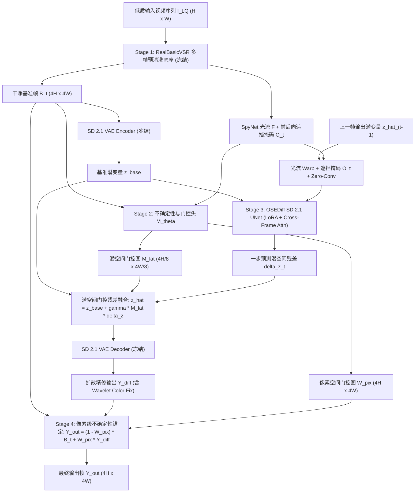

# Part 3 进阶技术方案：基于多帧预清洗与不确定性引导的一步扩散真实世界视频超分（UA-RealDiffVSR）

> **用途**：供小组成员对齐 Part 3 下一阶段目标、技术路线、代码隐患修正与分工排期（可直接放入仓库 `p3/docs/` 目录）。  
> **核心定位**：把大体量扩散生成先验（OSEDiff / SD 2.1）放回它真正占优的 **Real-World VSR（真实复杂退化视频超分）** 主场，结合多帧预清洗底座与 Direction C 不确定性门控，端到端训练一个在**真实压缩/模糊/噪声视频**上兼具“高清晰度、低闪烁、不歪字”的强模型。

---

## 一、为什么需要转向：复盘 P3 现状与核心瓶颈

截至目前，小组在 P0–P3 已经完成了极高质量的基础建设：全量 30 clip 统一评测（含正式 tLP/FID）、DISTS/MUSIQ/DOVER 感知指标归因、EDVR 感知微调（REDS 30/30 片段 LPIPS −31.2%，tLP −36.6%）、不确定性校准、以及 5 个外部生成模型（Real-ESRGAN / StableSR / OSEDiff / SUPIR / DOVE）与自研 U-TRD 的排查。

### 1.1 之前“融合大模型”一直难出效果的 3 个根本原因

1. **扔掉了多帧亚像素信息**：把单帧 LR 直接送进 OSEDiff / SUPIR，大模型只能靠先验“盲猜”纹理，浪费了视频相邻帧中真实的亚像素互补细节。
2. **输出端像素融合存在相位错位**：扩散模型重绘的高频纹理与回归模型（EDVR）存在 1～3 像素相位偏移，在 RGB 输出端做加权平均只会互相抵消（这正是 `stablesr_fusion` 中连 oracle 上限也仅有 `+0.020 dB` 的原因）。
3. **零样本退化域失配**：OSEDiff / SUPIR / DOVE 都是在重度真实退化（模糊 + 噪声 + 压缩）上训练的；不微调直接喂干净 bicubic 数据，必然出现过度重绘、PSNR 暴跌 6～9 dB、纹理块 LPIPS 暴涨 150%～200%。

> [!IMPORTANT]
> **正确的大模型融合范式**（对标 2024–2025 顶会 DLoRAL / Upscale-A-Video / MGLD-VSR / STAR）：
> **不要在像素输出端硬拼两个独立的冻结模型**，而是用多帧 VSR 做前级清洗与结构对齐，把对齐后的结果送入扩散大模型，在 **Latent（潜空间）做残差精修 + 轻量 LoRA 与时序适配微调**。

### 1.2 复盘中发现的 3 个代码/协议隐患（全组需知悉并修正）

| 隐患位置 | 具体问题 | 影响与处理方式 |
|---|---|---|
| [p3/utrd/scripts/model.py](https://github.com/logiyaxh-droid/aiaa3201-proj/blob/main/p3/utrd/scripts/model.py#L40-L42) & [L163-L197](https://github.com/logiyaxh-droid/aiaa3201-proj/blob/main/p3/utrd/scripts/model.py#L163-L197) | 冻结 EDVR 残差 $R = \text{GT} - B$ 的 RMSE 仅约 `0.024`，但噪声幅值 `c` 设在 `[0.1, 1.0]`（高出信号 15～40 倍），且 `x0_from_eps` 除以 $\sqrt{0.05} \approx 0.2236$ 将 $\hat\epsilon$ 误差放大 **4.36 倍**。 | 解释了 `diag_temp.py` 即使零起始噪声仍掉 1.8～3.1 dB 的现象。新主线改用**一步潜空间残差预测**，彻底规避该数值爆炸。 |
| [p3/prior_qualification/scripts/run_edvr_vlq.py](https://github.com/logiyaxh-droid/aiaa3201-proj/blob/main/p3/prior_qualification/scripts/run_edvr_vlq.py#L61-L70) | 第 61 行注释写传入真实邻帧，但第 70 行实际执行 `x[None].repeat(5, 1, 1, 1)[None]`（单帧重复 5 次，我们在 `p0/tasks/edvr_neighbor` 证明过这会让 EDVR 掉 2.76 dB）；且第 68 行用了无抗锯齿的 `cv2.INTER_CUBIC`。 | 后续引用 VideoLQ 数据前必须修正此脚本重跑（耗时仅 ~36 秒）。 |
| [p3/prior_qualification/scripts/build_realvsr_subset.py](https://github.com/logiyaxh-droid/aiaa3201-proj/blob/main/p3/prior_qualification/scripts/build_realvsr_subset.py#L67-L70) | RealVSR 原生 LQ 为 512×1024（相对 GT 约 2× 光学模糊），为适配 ×4 模型对其再做了一次 PIL BICUBIC ×4 下采样到 128×256。 | 强低通滤波切掉了原光学退化频带，使输入变回“以干净 ×4 bicubic 为主导”，天然偏向 EDVR。报告写 RealVSR 结论时必须如实标注此混杂因素。 |

---

## 二、评测基准重建：先立好公平的“真实退化战场”

为了同时解决 **VideoLQ 无 GT**、**REDS bicubic 偏干净**、**RealVSR 混杂 bicubic 重采样**三个问题，新主线统一在三个互补基准上评测：

| 基准 | 数据来源与退化 | 有无 GT | 固定协议 | 核心指标 |
|---|---|---|---|---|
| **1. `REDS-Real`（主定量表）** | REDS `val_sharp`（30 clips × 100 帧）经标准 **RealBasicVSR 二阶视频退化**（模糊 + 缩放 + 高斯/泊松噪声 + `libx264` CRF 24–38 压缩） | **有精确 GT** | 一次性离线生成 30 clip 退化输入并冻结 SHA256 清单，所有方法严格吃同一份 LR | PSNR / SSIM / **LPIPS** / **DISTS** / **tLP** / **DOVER** / **$E_{\text{warp}}$** |
| **2. 官方 `VideoLQ`（修正协议）** | 50 段真实网络低质视频（320×240 ～ 720×576） | 无 GT | **保持原生分辨率直接 ×4 超分**（如 320×240 → 1280×960），禁止再缩小到 80×60 | **DOVER（技术 + 美学）** / **MUSIQ** / **CLIPIQA+** / **$E_{\text{warp}}$** |
| **3. `p2/wild_source`（演示视频）** | 5 段手机自拍原始视频 | 无 GT | 原生/裁剪片段直接 ×4，合成 2×2 对比 MP4 + 双区域放大 loupe（文字区 + 纹理区） | 肉眼主观质量 + DOVER / $E_{\text{warp}}$ |

> [!TIP]
> **新增无参考时序指标 $E_{\text{warp}}$（遮挡感知光流重投影误差）**：直接复用 `p0/tasks/align/` 已验证的前后向光流一致性遮挡掩码 $O_t$，计算 $E_{\text{warp}} = \frac{\sum O_t \cdot \|\hat{Y}_t - \mathcal{W}(\hat{Y}_{t-1})\|_1}{\sum O_t}$。这样在无 GT 的 `VideoLQ` 和 `wild_source` 上也能严格定量评测“闪烁程度”。

---

## 三、核心模型架构：`UA-RealDiffVSR`

### 3.1 为什么选择 `RealBasicVSR` + `OSEDiff (SD 2.1)`？

| 候选大模型 | 实测显存 | 推理速度 | 能否单卡微调 LoRA/时序 | 适配结论 |
|---|---|---|---|---|
| StableSR (200 步) | ~12 GB | 5.2–5.9 分钟/帧 | 极慢，无法端到端像素反传 | 放弃 |
| SUPIR v0F (SDXL) | 12–15 GB | ~7 秒/帧（20 步） | 多步难反传，显存吃紧 | 仅作外部参照 |
| DOVE 5B (CogVideoX) | ~47 GB（不 tile） | 依赖重度 tile | 4×A100 80GB 级别，单卡不可训 | 仅作外部参照 |
| **`OSEDiff` (SD 2.1, 1 步)** | **4.55 GB** | **~0.15 秒/帧** | **单卡 24 GB / 48 GB 可直接端到端反传微调 LoRA + 时序层** | **最佳大模型主干** |

同时，前级搭配 **`RealBasicVSR`**（官方权重仅 ~6.3M 参数，内置清洗模块 + 双向传播 + SpyNet 光流）具备天然优势：
- `RealBasicVSR` 专为真实压缩/模糊/噪声视频设计，直接输出去块去噪、时序稳定的 ×4 基准帧 $B_t$；
- 查看 [run_osediff_realvsr.py](https://github.com/logiyaxh-droid/aiaa3201-proj/blob/main/p3/prior_qualification/scripts/run_osediff_realvsr.py#L122)，OSEDiff 原本就吃 `Lanczos ×4` 后的 HR 尺寸图再进 VAE——把 `Lanczos ×4` 替换成 `RealBasicVSR` 输出 $B_t$，**张量尺寸 `[B, 3, 4H, 4W]` 零改动无缝衔接**！

### 3.2 系统整体结构图

### 3.3 四个核心模块设计要点

1. **Stage 1：多帧预清洗与时序底座（冻结 `RealBasicVSR`）**
   - 负责清除 H.264 压缩块、振铃和传感器噪声，利用多帧双向传播聚合真实亚像素细节，产出干净但偏软的基准帧 $B_t$，以及现成的帧间光流 $F_{t\to t-1}$ 与遮挡掩码 $O_t$。
   - **收益**：让后级 SD 2.1 不再把压缩伪影误当成真实纹理去放大，大幅降低脑补风险。

2. **Stage 2：Direction C 不确定性估计与可学习门控头 $M_\theta$**
   - **输入特征**：Stage 1 的水平翻转分歧 $U_1$（校准良好的误差代理）、光流重投影残差 $U_{\text{warp}} = |B_t - \mathcal{W}(B_{t-1})| \odot O_t$、以及 $B_t$ 的局部梯度特征。
   - **为什么加轻量可学习门控头 $M_\theta$（~0.1M 参数）？** 单纯用拉普拉斯高频 `U4_lap` 会把招牌文字也标成高分，送给扩散模型容易变乱码；让轻量 CNN 门控头在端到端损失下自动学习区分“需要保真的文字/锐利边缘”和“需要生成的随机自然纹理（树叶、砖墙、织物）”，同时在消融实验里保留固定 $U_1$ / 固定常数权重作为严格对照。

3. **Stage 3：时序条件一步扩散（OSEDiff UNet 改造）**
   - **潜空间残差化**：冻结 SD 2.1 主干，仅训 **LoRA（rank 16）**，输出潜空间残差 $\Delta z_t$：
     $$\hat{z}_t = z_{B_t} + \gamma \cdot M_{\text{lat}}(U_t) \odot \Delta z_t$$
   - **光流潜空间递归（Zero-Conv 注入）**：将上一帧最终潜变量按光流 warp 到当前帧 $\tilde{z}_{t-1} = \mathcal{W}(\hat{z}_{t-1}, F_{t\to t-1})$，在非遮挡区构造差值 $(\tilde{z}_{t-1} - z_{B_t}) \odot O_t$，经一个**零初始化卷积（Zero-Conv）**注入 UNet 输入层。初始化时恒为 0，不破坏预训练权重，随训练逐步学会把已生成的纹理沿光流稳定传递到后续帧。
   - **轻量跨帧注意力（Cross-Frame Self-Attention）**：将 UNet 自注意力中的 Key/Value 扩展拼接上一帧（或窗口首帧）的 token，搭配轻量 1D Temporal Conv，进一步消除局部纹理高频闪烁。

4. **Stage 4：像素级不确定性锚定（绕开 SD 2.1 VAE 细节损失）**
   - SD 2.1 VAE（8× 空间下采样）本身在细小文字与锐利直线处存在重建损失。因为经过 Stage A 微调后 $Y_{\text{diff}}$ 与 $B_t$ 已严格像素对齐，最终在像素端做门控融合：
     $$\hat{Y}_t = (1 - W_{\text{pix}}(U_t)) \odot B_t + W_{\text{pix}}(U_t) \odot \text{WaveletFix}(Y_{\text{diff}}, B_t)$$
   - 平坦区与文字区直通 $B_t$（零 VAE 糊化、零乱码、时序绝对稳定）；复杂纹理区采用 $Y_{\text{diff}}$ 释放 SD 2.1 的强纹理先验。

---

## 四、训练数据、两阶段策略与损失函数

### 4.1 训练数据准备（避免 20 clip 过拟合）

- **冒烟验证**：可先用课程共享盘的 `train_sample_sharp`（20 clips）跑通代码与前反向梯度检查。
- **正式训练**：务必在借用服务器上补齐 **REDS 完整训练集（240 clips × 100 帧）**（用已验证的多线程下载脚本 `pdl.py` 加速）。
- **在线随机退化（On-the-fly Degradation）**：每次采样连续 $T=3$ 帧 GT，在线随机施加 RealBasicVSR 风格退化（各向同性/异性高斯模糊 + 随机缩放 + 高斯/泊松噪声 + 模拟 JPEG/H.264 压缩）。每轮退化组合都不同，极大降低过拟合风险。

### 4.2 两阶段训练配置（适配单卡 24 GB 4090 / 48 GB A6000）

| 训练阶段 | 冻结部分 | 训练部分 | 精度 / 分辨率 / 显存 | 步数与预估耗时 |
|---|---|---|---|---|
| **Stage A（空间域适配与对齐）** | `RealBasicVSR`、VAE、SD2.1 UNet 主干 | UNet **LoRA (r=16)** + 门控头 $M_\theta$ | `bf16/fp16` + grad checkpointing，HR crop `512×512`（LR `128×128`），约 **14～18 GB** | 5k～10k 步（batch 4–8，约 4～8 小时） |
| **Stage B（时序联合微调）** | 同上（空间 LoRA 用小 lr 协同微调或冻结） | **Zero-Conv 潜空间递归** + **Temporal Conv/Attn** + $M_\theta$ | 连续 **3 帧**，HR crop `512×512`（或 `384×384`），约 **20～28 GB** | 3k～6k 步（约 5～10 小时） |

### 4.3 联合损失函数（复用 `p3/quality_metrics/fine_tune/` 已验证配方）

$$\mathcal{L} = \mathcal{L}_{\text{Charb}}(\hat{Y}_t, Y_t) + \lambda_{\text{per}} \mathcal{L}_{\text{DISTS}}(\hat{Y}_t, Y_t) + \lambda_{\text{gan}} \mathcal{L}_{\text{RaGAN}}(\hat{Y}_t, Y_t) + \lambda_{\text{temp}} \mathcal{L}_{\text{temp}}$$

- **空间项（Stage A & B）**：Charbonnier（权重 `1.0`）+ DISTS（参考初始 `0.05`）+ SN-UNet Relativistic GAN（参考初始 `0.002`）。一步扩散可直接从像素端反传梯度到 UNet LoRA。
- **遮挡感知时序差分损失（Stage B 新增）**：
  $$\mathcal{L}_{\text{temp}} = \left\| O_t \odot \left( (\hat{Y}_t - \mathcal{W}(\hat{Y}_{t-1})) - (Y_t - \mathcal{W}(Y_{t-1})) \right) \right\|_1$$
  该损失要求**输出帧间变化逼近 GT 帧间变化**，而非强行平滑两帧，从而在压低 `tLP` 和 $E_{\text{warp}}$ 的同时不拖糊运动纹理。

---

## 五、四阶段执行里程碑与 Go/No-Go 门槛

| 里程碑 | 时间预估 | 核心任务 | 通过门槛（Go / No-Go） |
|---|---|---|---|
| **M1：基准重建 + 零样本探针** | Day 1–2 | 1. 编写 `build_reds_real.py` 生成并冻结 30 clip `REDS-Real`； 2. 修正 VideoLQ 原生 ×4 评测与 `run_edvr_vlq.py` 重复帧 bug； 3. 下载 `RealBasicVSR` 官方权重，跑通全基线表 + **零样本串联 `RealBasicVSR → OSEDiff`**（含 Cross-Frame Attn 零训练版）。 | 在 `REDS-Real` 上确认：干净 `EDVR` 退化失配崩盘；`RealBasicVSR → OSEDiff` 零样本即显著改善压缩伪影，且清晰暴露“时序闪烁 + 细节偏离”靶点。 |
| **M2：Stage A 空间残差 LoRA + 门控训练** | Day 3–5 | 1. 准备 REDS 240 clips 训练集与在线退化 dataloader； 2. 完成单帧 **LoRA + 潜空间残差 + 像素门控 $M_\theta$** 训练； 3. 在 dev 3 clips 上验证并输出视觉局部放大图（文字区 + 纹理区）。 | 相比原版 `OSEDiff`：PSNR 提升 **≥ 1.5 dB**，LPIPS/DISTS 更优，文字无明显畸变；相比 `RealBasicVSR`：LPIPS 改善 **≥ 15%**，视觉锐度肉眼显著胜出。 |
| **M3：Stage B 时序机制联合微调** | Day 6–8 | 1. 接入 SpyNet 光流潜变量 Zero-Conv 递归 + Cross-Frame Attn / 1D Temporal Conv； 2. 连续 3 帧序列联合训练 + $\mathcal{L}_{\text{temp}}$； 3. 跑完 dev 3 clips 与 10 clips 扩展验证。 | 相比 Stage A：在 LPIPS/DISTS 基本不退化（波动 < 3%）的前提下，`tLP` 和 $E_{\text{warp}}$ 明显下降（目标 **−20% 以上**），视频播放肉眼无明显闪烁。 |
| **M4：全量评测、消融与报告/Demo 交付** | Day 9–10 | 1. 跑满 `REDS-Real`（30 clips）与原生 `VideoLQ`（50 clips）全量表； 2. 补齐消融项（无 LoRA / 无门控 / 固定 $U_1$ / 可学习 $M_\theta$ / 无时序）； 3. 合成 `REDS-Real` 与 `wild_source` 2×2 高清演示视频，重写 `P3_report_draft.md` 与 `README.md`。 | 所有表、图、视频均由统一脚本自动生成并可复核；完整闭环 Part 1 → Part 2 → Part 3 叙事。 |

---

## 六、小组分工建议与最终消融表模板

### 6.1 推荐并行分工（适用于 2–4 人小组）

- **数据与评测负责人**：编写 `build_reds_real.py`、冻结测试集哈希、修正 `run_edvr_vlq.py` 并统一维护 `REDS-Real` + 原生 `VideoLQ` 评测脚本（含 $E_{\text{warp}}$ 与 DOVER 指标）、跑齐所有外部基线（EDVR / FT-EDVR / RealBasicVSR / OSEDiff / SUPIR / DOVE）。
- **模型与训练负责人**：拉取 REDS 240 clips 训练集、实现 `RealBasicVSR → OSEDiff` 串联与 LoRA / Zero-Conv 递归 / Cross-Frame Attn / 门控头 $M_\theta$ 代码、主导 Stage A 与 Stage B 训练及显存调优。
- **诊断、可视化与报告负责人**：负责局部放大对比图（文字区 / 平坦区 / 纹理区）、不确定性门控图可视化（证明 $M_\theta$ 确实在文字区压低权重、在纹理区放开权重）、2×2 对比演示视频合成、以及重构 `P3_report_draft.md` 与主 `README.md`。

### 6.2 最终报告主表与消融表模板（所有工作直接填表）

| 方法 / 消融变体 | `REDS-Real` PSNR ↑ | `REDS-Real` LPIPS ↓ | `REDS-Real` DISTS ↓ | `REDS-Real` tLP ↓ | 原生 `VideoLQ` DOVER ↑ | 原生 `VideoLQ` MUSIQ ↑ | 原生 `VideoLQ` $E_{\text{warp}}$ ↓ | 显存 / 单帧耗时 |
|---|---:|---:|---:|---:|---:|---:|---:|---:|
| Bicubic ×4 | — | — | — | — | — | — | — | — |
| EDVR-L（干净域基线） | — | — | — | — | — | — | — | — |
| 感知微调 EDVR（P3 早期正向） | — | — | — | — | — | — | — | — |
| RealBasicVSR（Stage 1 底座） | — | — | — | — | — | — | — | — |
| OSEDiff（原版单帧大模型） | — | — | — | — | — | — | — | — |
| SUPIR v0F / DOVE 5B（外部大模型参照） | — | — | — | — | — | — | — | — |
| **Ours (w/o LoRA，零样本串联)** | — | — | — | — | — | — | — | — |
| **Ours (Stage A，+潜空间 LoRA 残差)** | — | — | — | — | — | — | — | — |
| **Ours (+固定不确定性 $U_1$ 门控)** | — | — | — | — | — | — | — | — |
| **Ours (+可学习门控 $M_\theta$)** | — | — | — | — | — | — | — | — |
| **Ours (Full，+Stage B 时序递归与注意力)** | — | — | — | — | — | — | — | — |

---

## 七、明确止损红线（不再投入精力的方向）

1. **停止在干净 REDS bicubic 上强行追求“外部生成先验击败 EDVR”**：既有实验（Real-ESRGAN / StableSR / OSEDiff / SUPIR / DOVE）已构成完整负结果证据链，直接作为报告前半段“为什么要转向 Real-World VSR”的强动机即可。
2. **停止折腾 DOVE 5B on RealVSR 的 OOM 与 MVSR4x 慢速下载**：对新主线没有任何增益。
3. **停止继续加大预算硬训像素空间 U-TRD**：算力全部集中到基于 SD 2.1 预训练先验的 `UA-RealDiffVSR`。
